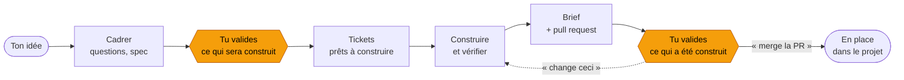
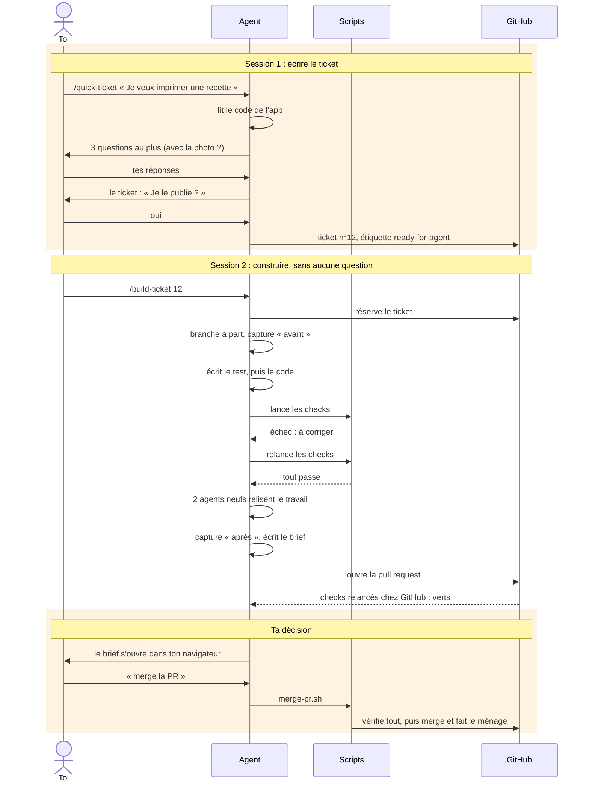

# an-forge

  

**an-forge transforme une idée en logiciel qui fonctionne, sans que tu écrives une ligne de code.** Tu dis ce que tu veux, des agents IA le construisent, et des contrôles automatiques les empêchent de livrer quelque chose de faux. Tu gardes la décision du début à la fin.

[En 30 secondes](#an-forge-en-30-secondes) · [Les mots à connaître](#les-mots-à-connaître) · [Un exemple](#un-exemple-de-bout-en-bout) · [Installation](#installation)

---

## an-forge en 30 secondes

Imagine **un atelier**. Tu es le chef d'atelier : tu dis ce qu'il faut fabriquer et tu valides le résultat. Les **agents** sont les ouvriers : ils réfléchissent, fabriquent et se relisent entre eux. Les **scripts** sont les machines de contrôle : elles mesurent sans jamais se tromper, et sans jamais se laisser convaincre.

### La chaîne complète



Tu n'interviens qu'**à deux moments**, en orange :

1. **Avant** : tu valides *ce qui va être construit*. L'agent te pose des questions, puis te montre la spec et les tickets. Rien n'est publié sans ton oui.
2. **Après** : tu valides *ce qui a été construit*. Tu lis un brief d'une page, avec des captures d'écran avant/après, puis tu dis « merge la PR » ou ce qu'il faut changer.

Entre les deux, l'agent travaille seul, sans te poser de questions.

### Qui fait quoi

```mermaid
flowchart LR
    subgraph toi["Toi : décider"]
        direction TB
        t1["Dire ce que tu veux"]
        t2["Valider la spec et les tickets"]
        t3["Lire le brief, dire « merge »"]
    end
    subgraph agents["Les agents : juger"]
        direction TB
        a1["Poser les bonnes questions"]
        a2["Écrire le code et les tests"]
        a3["Relire le travail d'un autre agent"]
    end
    subgraph scripts["Les scripts : mesurer"]
        direction TB
        s1["Lancer les tests"]
        s2["Refuser un merge risqué"]
        s3["Calculer les chiffres du brief"]
    end
    toi -->|"une demande"| agents
    agents -->|"un travail à contrôler"| scripts
    scripts -->|"refusé : à corriger"| agents
    agents -->|"un brief"| toi
```



**Pourquoi séparer agents et scripts ?** Un agent IA est très bon pour réfléchir, mais il peut se tromper ou présenter son travail sous un jour trop favorable. Un script fait toujours exactement la même chose. On confie donc aux agents ce qui demande du jugement, et aux scripts tout ce qui doit être exact : les tests ont-ils passé ? le projet est-il à jour ? le merge est-il sans danger ?

## Les mots à connaître

| Mot | En une phrase | Image |
|-----|---------------|-------|
| **Repo** | Le dossier du projet, avec tout son historique, rangé sur GitHub | Le classeur du projet |
| **`main`** | La version officielle du projet, celle qui marche | L'original, rangé au coffre |
| **Branche** | Une copie de travail à part, où l'agent modifie sans toucher `main` | Une photocopie sur laquelle on peut raturer |
| **Spec** | La description complète d'une grosse évolution : le quoi et le pourquoi | Le cahier des charges |
| **Ticket** | Un morceau de travail assez petit pour être construit en une fois | Une fiche de travail pour un ouvrier |
| **Étiquette** | Un mot posé sur un ticket pour dire où il en est (`ready-for-agent`…) | Le post-it de couleur sur la fiche |
| **Test** | Un petit programme qui vérifie qu'une fonction fait bien ce qu'on attend | Le gabarit qui vérifie qu'une pièce a la bonne taille |
| **TDD** | Écrire le test *avant* le code | Fabriquer le gabarit avant la pièce |
| **Checks** | L'ensemble des contrôles automatiques : tests, vérifications du code | Le contrôle qualité en sortie de chaîne |
| **PR** (pull request) | La demande de ramener une branche dans `main` | « Voici ma photocopie corrigée, je propose qu'elle remplace l'original » |
| **Merge** | Accepter la PR : la branche rejoint `main` | Ranger la nouvelle version au coffre |
| **Brief** | La page de synthèse que tu lis avant de merger | Le compte rendu du chef d'équipe |
| **Skill** | Une fiche d'instructions qui apprend à l'agent une façon de travailler | Une fiche de procédure de l'atelier |
| **Plugin** | Le paquet qui installe tous les skills d'an-forge d'un coup | La caisse à outils livrée complète |

## Un exemple de bout en bout

Tu as une app de recettes, et tu voudrais pouvoir **imprimer une recette**. C'est une petite demande : un seul comportement, on passe donc par le chemin court, `/quick-ticket`. Pour une grosse évolution, ce serait `/project-launch`, qui commence par une spec.



Ce qu'il faut retenir :

- **Deux sessions, deux rôles.** La première prépare le travail avec toi, la seconde l'exécute seule. Une session neuve par ticket : l'agent démarre l'esprit clair, sans les détours de la conversation précédente.
- **Les échecs sont normaux.** Des checks qui échouent, puis l'agent qui corrige, c'est la chaîne qui fait son travail. Ce que tu reçois a déjà passé tous les contrôles.
- **Si le brief ne te plaît pas**, tu ne dis pas « merge » mais ce qui ne va pas (« le bouton est trop petit »). L'agent corrige, refait les contrôles et te donne un brief à jour.
- **Si l'agent bloque** (le ticket est trop flou, ou une erreur revient trois fois), il ne devine pas : il écrit sa question ou son problème sur le ticket, sur GitHub, et s'arrête.

🗺️ Pour tout voir d'un coup : [la carte interactive d'an-forge](docs/skill-map/index.html). Un double-clic sur un skill ouvre son détail, jusqu'aux scripts.

[](docs/skill-map/index.html)

---

> [!NOTE]
> La suite du README n'est pas encore réécrite.

## Installation

Une seule fois par machine, selon ton agent. an-forge contient tout ce dont il a besoin.

```bash
# Claude Code (mises à jour automatiques)
claude plugin marketplace add arthurnicolas59/an-forge
claude plugin install an-forge@an-forge

# Autres agents (copie les skills dans le projet)
npx skills@latest add arthurnicolas59/an-forge
```

> [!NOTE]
> N'installe pas en plus le plugin de Matt Pocock : chaque skill apparaîtrait en double.

Si le plugin ne se met pas à jour seul : `claude plugin marketplace update an-forge`, puis `claude plugin update an-forge@an-forge`.

Les captures et le PDF du brief utilisent Playwright : il faut Node.js 20 ou plus. La première fois, Playwright télécharge Chromium (environ 150 Mo).

## 1. Initier le projet

Une seule fois par projet, neuf ou existant : **`/project-init`**.

- Inspecte le projet (git, GitHub, fichiers existants).
- Pose `AGENTS.md`, `scripts/checks.sh` et `.github/workflows/checks.yml`, sans jamais écraser un fichier existant.
- Te demande seulement si tu es développeur. Sur un projet existant, il déduit les règles et les checks du code ; sur un projet neuf, c'est `/project-launch` qui les fixe.
- Lance `setup-matt-pocock-skills` (outil de tickets, emplacement des docs), crée les étiquettes GitHub (`ready-for-agent`…), puis crée `CLAUDE.md` avec `@AGENTS.md`.
- Après le premier push, protège `main`.

`CLAUDE.md` est créé en dernier exprès : le setup écrit sa configuration dans `CLAUDE.md` s'il existe, sinon dans `AGENTS.md`. Toute la configuration reste ainsi dans `AGENTS.md`, lisible par tous les outils.

## 2. Cadrer le projet

| Demande | Commande | Résultat |
|---------|----------|----------|
| Un projet, une grosse évolution | `/project-launch` | une spec et des tickets `ready-for-agent` |
| Un bug, une retouche, un petit ajout | `/quick-ticket` | un seul ticket `ready-for-agent` |

`/project-launch` enchaîne, dans une seule conversation :

1. `grill-with-docs` : un interrogatoire serré, qui tient à jour `GLOSSARY.md` et les ADR.
2. Le cadre : pour un projet neuf, le choix de la stack (deux ou trois options, une recommandation à valider), puis `AGENTS.md`, `checks.sh` et le workflow GitHub remplis et poussés.
3. `to-spec` : la conversation devient une spec, publiée en issue. Elle ne se construit pas et se ferme avec son dernier ticket.
4. `to-tickets` : la spec est découpée en tranches complètes, chacune dans une session, avec leurs dépendances. Pour un projet neuf, le premier ticket est le socle.

Il s'arrête pour ton accord avant de pousser le cadre, de publier la spec, puis de créer les tickets. Si tu n'es pas développeur, aucune question technique ne t'est posée brute : tu reçois une recommandation expliquée simplement.

`/quick-ticket` pose trois questions au plus. Si la demande est trop grosse pour un ticket, il te renvoie vers `/project-launch`.

## 3. Construire le ticket

**`/build-ticket <n>`** construit un ticket `ready-for-agent` dans une session neuve, un ticket par session. Sans numéro (ou avec celui d'une spec), il prend le premier ticket libre, celui qui a le plus petit numéro. Il ne pose aucune question et enchaîne les étapes 3, 4 et 5, sans s'arrêter, jusqu'à la pull request.

Pour construire :

1. **Ménage** : `cleanup.sh` supprime les tickets déjà mergés et ferme les specs terminées.
2. **Isoler** : `start-ticket.sh` crée la branche `ticket/<n>-…` et un worktree dans `.worktrees/`, depuis le dernier `main`.
3. **Coder** : `tdd`, test d'abord, une tranche à la fois. Pour un bug, `diagnosing-bugs` le reproduit avant de le corriger.

**Le choix du modèle.** Chaque ticket a une taille (`taille:petit`, `taille:moyen`, `taille:gros`), posée par `/quick-ticket` et `/to-tickets` ; sans étiquette, un agent Haiku la décide. `scripts/pick-model.sh` en tire le modèle de l'agent qui construit.

| Commande | Taille | Modèle de construction |
|----------|--------|------------------------|
| `/build-ticket` | petit | Sonnet |
| `/build-ticket` | moyen, gros | Opus |
| `/build-ticket --eco` | toutes | Sonnet |
| `/build-ticket --max` | toutes | Opus |

Les relectures restent toujours sur le plus capable. Pour un projet déjà préparé, relance `create-labels.sh` du skill `project-init` pour créer les trois étiquettes. Les tests : `bash tests/test-pick-model.sh`.

**Quand ça coince, ça se voit sur GitHub.**
- Un ticket impossible à construire sans deviner : l'agent écrit sa question sur le ticket, avec l'étiquette `needs-info`, et passe au suivant.
- Une construction qui s'arrête en route (checks en échec trois fois, par exemple) : commentaire sur le ticket, avec l'étiquette `ready-for-human`.

**Un ticket à la fois par défaut.** Le parallèle est possible, avec une session par ticket : chaque session réserve un ticket en créant sa branche. Mais deux changements corrects séparément peuvent se contredire une fois réunis, et une base de développement reste partagée. Choisir quels tickets avancent ensemble serait le rôle d'un futur orchestrateur `/factory`, qui n'existe pas encore.

## 4. Vérifier le ticket

Rien n'avance tant que la vérification échoue.

1. **Tester** : `gate.sh` lance `scripts/checks.sh`. Une branche qui modifie les checks est refusée.
2. **Relire** : des agents neufs, qui ne voient que le diff, le ticket et les règles du projet. `code-review` vérifie les règles et la fidélité au ticket ; `risk-review` cherche les bugs, les failles de sécurité et les risques pour les données, et donne le niveau de risque. Deux tours au maximum.
3. **Recontrôler chez GitHub** : à l'ouverture de la PR, GitHub relance les checks sur une machine neutre, et l'agent corrige s'ils échouent.

## 5. Livrer le ticket

1. **Résumer** : `before-after` capture les écrans avant et après, `feature-brief` écrit le brief dans `docs/briefs/` : une page de synthèse (décision, objectif, avant/après, fiabilité, choix effectués, comment l'essayer), puis une annexe avec les critères du ticket, chacun avec sa preuve, et les fichiers touchés.
2. **Ouvrir la PR** : une pull request avec `Closes #<n>` et le lien du brief.
3. **Merger** : tu lis le brief, puis tu dis « merge la PR ». `merge-pr.sh` ne merge que si la PR contient le dernier `main`, que les checks ont passé sur exactement cette version, et que ceux de GitHub sont verts.

**Après le brief**, deux réponses possibles : « merge la PR », ou dire ce qui ne convient pas. L'agent corrige alors, relance checks et relectures, et redonne un brief à jour. Une demande qui sort du ticket devient un nouveau ticket (`/quick-ticket`).

L'état d'un ticket vit sur GitHub (étiquettes, commentaires, sous-issues), pas dans des fichiers locaux.

## Skills

| Étape | Skill | Rôle | Origine |
|-------|-------|------|---------|
| 1 | [`project-init`](skills/project-init/SKILL.md) | Prépare un repo pour la factory | an-forge |
| 1 | [`setup-matt-pocock-skills`](skills/setup-matt-pocock-skills/SKILL.md) | Configure un projet (tickets, étiquettes, docs) | Matt Pocock |
| 2 | [`project-launch`](skills/project-launch/SKILL.md) | De l'idée aux tickets : grill, spec, tickets | an-forge |
| 2 | [`quick-ticket`](skills/quick-ticket/SKILL.md) | D'une petite demande à un seul ticket | an-forge |
| 2 | [`grill-with-docs`](skills/grill-with-docs/SKILL.md) | Interrogatoire, glossaire et ADR | Matt Pocock |
| 2 | [`grilling`](skills/grilling/SKILL.md) | L'interrogatoire, utilisé par `grill-with-docs` | Matt Pocock |
| 2 | [`domain-modeling`](skills/domain-modeling/SKILL.md) | Glossaire et ADR, utilisé par `grill-with-docs` | Matt Pocock |
| 2 | [`to-spec`](skills/to-spec/SKILL.md) | Conversation → spec publiée en issue | Matt Pocock |
| 2 | [`to-tickets`](skills/to-tickets/SKILL.md) | Spec → tickets `ready-for-agent` | Matt Pocock |
| 3 à 5 | [`build-ticket`](skills/build-ticket/SKILL.md) | D'un ticket à une PR ; reprise sur demande | an-forge |
| 3 | [`tdd`](skills/tdd/SKILL.md) | Construire test d'abord, une tranche à la fois | Matt Pocock |
| 3 | [`diagnosing-bugs`](skills/diagnosing-bugs/SKILL.md) | Reproduire un bug avant de le corriger | Matt Pocock |
| 3 | [`codebase-design`](skills/codebase-design/SKILL.md) | Vocabulaire de conception, utilisé par `tdd` | Matt Pocock |
| 4 | [`risk-review`](skills/risk-review/SKILL.md) | Bugs, failles, risques pour les données ; niveau de risque | an-forge |
| 4 | [`code-review`](skills/code-review/SKILL.md) | Relire le diff selon les règles et la spec | Matt Pocock |
| 5 | [`before-after`](skills/before-after/SKILL.md) | Captures des mêmes écrans avant et après | an-forge |
| 5 | [`feature-brief`](skills/feature-brief/SKILL.md) | Brief pour le CEO : synthèse et annexe | an-forge |
| 5 | [`pr`](skills/pr/SKILL.md) | Rédiger le corps d'une pull request | Matt Pocock |
| transversal | [`visual`](skills/visual/SKILL.md) | Une page HTML : résumé de branche, plan, carte de skills | Eric Tech |

## Garde-fous

| Garde-fou | Ce qu'il fait |
|-----------|---------------|
| Checks en double | Une fois chez l'agent (`gate.sh`), une fois chez GitHub (`checks.yml`), comme un contrôle technique fait par un garage indépendant plutôt que par le vendeur |
| `merge-pr.sh` | Ne merge que si la PR contient le dernier `main`, que les checks ont passé sur exactement cette version, et que ceux de GitHub sont verts |
| Checks protégés | Une branche qui modifie les checks est refusée |
| Relecteurs neufs | Ils ne voient que le diff, le ticket et les règles du projet |
| Pas de merge seul | L'agent ne merge jamais de lui-même |
| `cleanup.sh` | Ménage automatique des tickets mergés et des specs terminées |

**Ce que l'agent ne peut pas embellir.** Dans le brief, trois informations ne viennent pas de l'agent qui a codé : le niveau de risque (donné par le relecteur indépendant), le résultat des checks et la liste des tests existants supprimés ou modifiés (calculés par les scripts).

> [!NOTE]
> Avec un compte GitHub gratuit, la protection de `main` n'existe que sur un repo public. Sur un repo privé, les checks tournent quand même et `merge-pr.sh` les respecte, mais le bouton « Merge » de GitHub ne vérifie rien.


## Cartes

On ne modifie que les données (`docs/skill-map/map.json`), puis :

```bash
scripts/build-maps.sh            # reconstruit les pages, vérifie que chaque skill figure sur la carte
scripts/build-maps.sh --thumbs   # refait aussi les vignettes de la page d'accueil
```

La vérification de la carte (flèches qui se croisent, étiquettes qui se chevauchent) utilise Google Chrome. Sans Chrome, les pages se construisent quand même, sans cette vérification.

## Mises à jour

Pour voir ce qui a changé chez Matt ou chez Eric depuis la dernière copie :

```bash
scripts/sync-upstream.sh                     # toutes les sources, résumé
scripts/sync-upstream.sh mattpocock --full   # une source, diff complet
```

## Structure du repo

```text
AGENTS.md         les règles de la factory (source unique, lisible par tous les outils)
CLAUDE.md         importe AGENTS.md pour Claude Code
skills/           un dossier par skill (SKILL.md, format ouvert Agent Skills)
agents/           un fichier par sous-agent (vide pour l'instant)
tests/            tests des scripts (tests/test-pick-model.sh)
scripts/          sync-upstream.sh, build-maps.sh, un .lock par source copiée
licenses/         licences des skills venus d'ailleurs
docs/             les cartes (données en map.json, pages générées par build-maps.sh)
.claude-plugin/   l'emballage pour Claude Code
```

| Élément | Claude Code | Autres outils (Codex, Cursor, Copilot, Gemini…) |
|---------|-------------|--------------------------------------------------|
| Règles et workflow | `AGENTS.md` via `CLAUDE.md` | `AGENTS.md` lu directement |
| Skills | plugin | `npx skills add` |
| Sous-agents | plugin | à adapter selon l'outil |

## Avancement

Fait :
- [x] Squelette et skills de Matt Pocock intégrés
- [x] `/project-init`, `/project-launch`, `/quick-ticket`
- [x] `/build-ticket` : isolation, TDD, checks, relectures, brief, PR, merge contrôlé
- [x] Checks relancés par GitHub, étiquettes `needs-info` / `ready-for-human`
- [x] Choix du modèle par taille de ticket
- [x] Cartes interactives de la factory (`docs/`)

À faire :
- [ ] Test sur un vrai projet (Recipe) : plusieurs tickets à la main
- [ ] Sous-agents dédiés (`agents/` est vide : les relectures passent par des skills)
- [ ] Tests automatiques des scripts et contrôle du bump de version
- [ ] Aperçu de déploiement par PR dans le ticket socle
- [ ] Orchestrateur `/factory` et parallèle, seulement après 10 à 20 tickets faits à la main

## Crédits

**Matt Pocock.** Ses skills sont copiés depuis [mattpocock/skills](https://github.com/mattpocock/skills) (licence MIT, voir [licenses/mattpocock-skills.txt](licenses/mattpocock-skills.txt)), pour qu'an-forge soit complet à lui seul. Modifications :
- `setup-matt-pocock-skills`, `grill-with-docs`, `to-spec` et `to-tickets` ne sont plus réservés au lancement manuel, pour qu'un skill an-forge puisse les appeler. Leur description demande de ne jamais les lancer de sa propre initiative.
- Les métadonnées de `pr` ont été retirées de l'en-tête ; les crédits restent dans `skills/pr/CREDITS.md`.

**Eric Tech.** Copiés depuis [EricTechPro/super-board](https://github.com/EricTechPro/super-board) (licence MIT, voir [licenses/super-board.txt](licenses/super-board.txt)) : le skill `visual`, le moteur de la carte de Matt (`docs/_shared/`) et la carte de Matt Pocock. `visual` est repris tel quel, sauf une retouche : le panneau de détail coupe aussi ses puces avant une majuscule accentuée. Dans le moteur, seuls la barre du haut, la liste des cartes, la comparaison entre packs et la reconnaissance des noms de skills dans un texte accentué ont été adaptés. Le design de ce README s'en inspire.

**Inspirations** (idées seulement) :
[rstack](https://github.com/michaelshimeles/rstack) · [zazencodes software factory v2](https://github.com/zazencodes/zazencodes-season-3/tree/main/src/software-factory-claude-code-v2)

---

*Fait par Arthur.*
