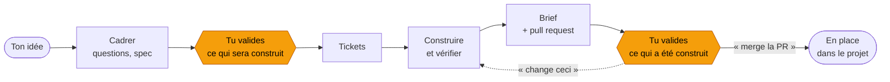
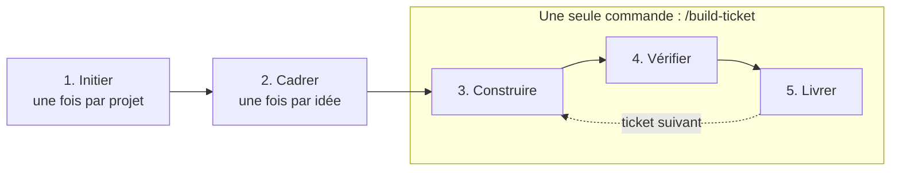
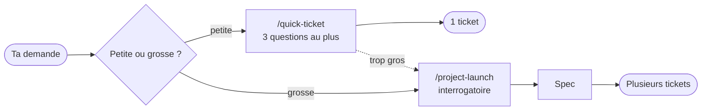
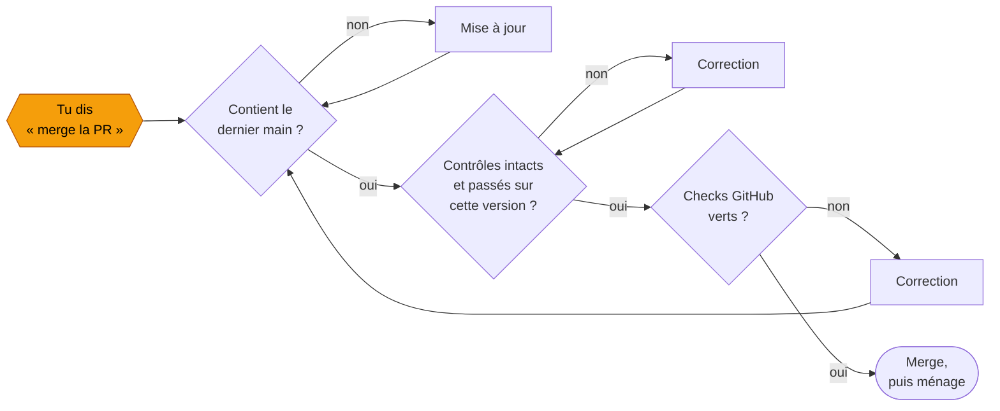
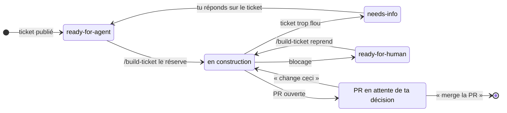
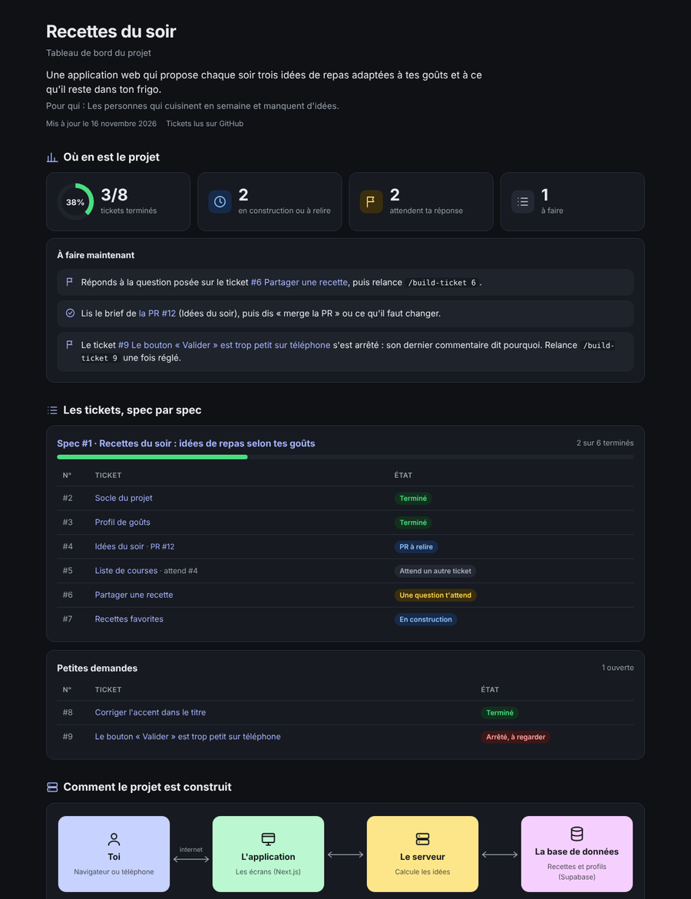
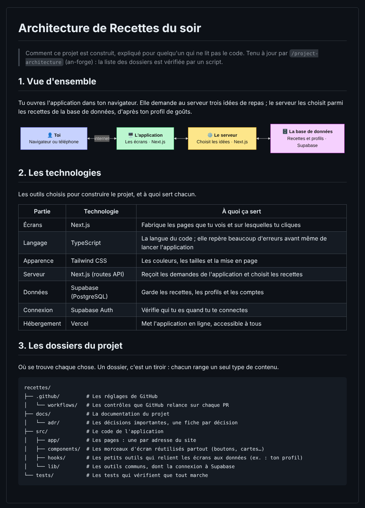
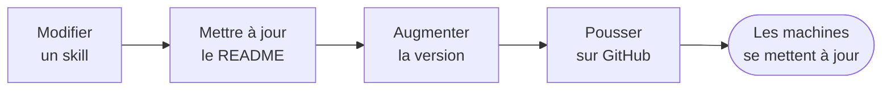

# an-forge

  

**an-forge transforme une idée en logiciel qui fonctionne, sans que tu écrives une ligne de code.** Tu dis ce que tu veux, des agents IA le construisent, et des contrôles automatiques les empêchent de livrer quelque chose de faux. Tu gardes la décision du début à la fin.

[En 30 secondes](#en-30-secondes) · [Les mots à connaître](#les-mots-à-connaître) · [Installation](#installation) · [1. Initier](#1-initier-le-projet) · [2. Cadrer](#2-cadrer) · [3. Construire](#3-construire) · [4. Vérifier](#4-vérifier) · [5. Livrer](#5-livrer) · [Tableau de bord](#le-tableau-de-bord) · [Fiche architecture](#la-fiche-architecture) · [Comprendre un projet](#comprendre-un-projet) · [Garde-fous](#les-garde-fous) · [Faire évoluer an-forge](#faire-évoluer-an-forge)

---

## En 30 secondes

Imagine **un atelier**.
- **Toi**, tu es le chef d'atelier : tu dis quoi fabriquer et tu valides le résultat.
- **Les agents** sont les ouvriers : ils réfléchissent, fabriquent et se relisent entre eux.
- **Les scripts** sont les machines de contrôle : elles mesurent toujours de la même façon, sans jamais se laisser convaincre.



Tu n'interviens qu'**à deux moments**, en orange :
1. **Avant** : tu valides ce qui va être construit.
2. **Après** : tu lis un brief d'une page, puis tu dis « merge la PR » ou ce qu'il faut changer.

Entre les deux, l'agent travaille seul.

**Pourquoi des agents *et* des scripts ?** Un agent est bon pour réfléchir, mais il peut se tromper ou embellir son travail. Un script fait toujours exactement la même chose. Les agents font donc ce qui demande du jugement, les scripts tout ce qui doit être exact : les tests ont-ils passé ? peut-on fusionner sans danger ?

**Skill ou script ?** Un **skill** est une fiche d'instructions que l'agent lit et suit, comme une fiche de procédure. Un **script** est un petit programme qui s'exécute sans réfléchir, comme une machine. Chaque étape ci-dessous liste les deux.

## Les mots à connaître

| Mot | En une phrase |
|-----|---------------|
| **Repo** | Le dossier du projet sur GitHub, avec tout son historique. |
| **`main`** | La version officielle du projet, celle qui marche. |
| **Branche** | Une copie de travail à part, où l'agent modifie sans toucher `main`. |
| **Spec** | Le cahier des charges d'une grosse évolution : le quoi et le pourquoi. |
| **Ticket** | Un morceau de travail assez petit pour être construit en une fois. |
| **Étiquette** | Un mot posé sur un ticket pour dire où il en est (`ready-for-agent`…). |
| **Test** | Un petit programme qui vérifie qu'une fonction fait ce qu'on attend. |
| **Checks** | L'ensemble des contrôles automatiques : tests et vérifications du code. |
| **PR** (pull request) | La demande de ramener une branche dans `main`. |
| **Merge** | Accepter la PR : la branche rejoint `main`. |
| **Brief** | La page de synthèse que tu lis avant de merger. |

---

## Installation

an-forge s'installe une fois sur ta machine et sert ensuite dans tous tes projets.

```bash
# Claude Code (les mises à jour arrivent toutes seules)
claude plugin marketplace add arthurnicolas59/an-forge
claude plugin install an-forge@an-forge

# Autres agents : Codex, Cursor, Copilot, Gemini… (copie les skills dans le projet)
npx skills@latest add arthurnicolas59/an-forge
```

> [!NOTE]
> N'installe pas en plus le plugin de Matt Pocock : an-forge contient déjà ses skills, ils apparaîtraient en double.

Si le plugin ne se met pas à jour tout seul : `claude plugin marketplace update an-forge`, puis `claude plugin update an-forge@an-forge`.

**En option, le panneau « Ticket statut »** (`forge-progress`) : il affiche dans Claude Code ce qu'il reste à faire sur le projet, et suit en direct le ticket en cours. Il s'ouvre avec `/ticket-statut`. Détails dans [`plugins/forge-progress/README.md`](plugins/forge-progress/README.md).

```bash
claude plugin install forge-progress@an-forge
```

Les captures d'écran et le PDF du brief demandent **Node.js 20 ou plus**. La première fois, un navigateur invisible (Chromium, environ 150 Mo) est téléchargé.

---

## Les 5 étapes



Tu ne tapes que **quatre commandes** : `/project-init`, `/project-launch` ou `/quick-ticket`, puis `/build-ticket`. Les étapes 3, 4 et 5 s'enchaînent toutes seules. À tout moment, `/project-dashboard` te montre où en est le projet.

---

## 1. Initier le projet

**Ce que tu fais** : une seule fois par projet, neuf ou existant, tu tapes `/project-init`. Tu réponds à une question : « Êtes-vous développeur ? ».

**Ce que tu obtiens** : un projet prêt à recevoir des tickets.
- `AGENTS.md` : le règlement du projet, lu par tous les agents.
- `scripts/checks.sh` : la liste des contrôles à lancer.
- `ARCHITECTURE.md` (projet existant) : comment le projet est construit, expliqué simplement. Pour un projet neuf, elle arrive à l'étape 2, une fois les technologies choisies.
- Sur GitHub : les étiquettes, et des contrôles relancés à chaque PR.

**Skills utilisés**

| Skill | Ce qu'il fait, concrètement |
|-------|-----------------------------|
| [`project-init`](skills/project-init/SKILL.md) | La commande que tu tapes. Regarde ce que contient le projet, pose les fichiers de base, te demande si tu es développeur, puis prépare GitHub. Sur un projet existant, il lit le code pour deviner les règles et les contrôles à lancer. |
| [`setup-matt-pocock-skills`](skills/setup-matt-pocock-skills/SKILL.md) *(Matt Pocock)* | Écrit trois petites fiches dans `docs/agents/` qui disent aux autres skills où vivent les tickets (GitHub ou fichiers), quelles étiquettes utiliser et où ranger la documentation. |

**Scripts utilisés**

| Script | Ce qu'il fait, concrètement |
|--------|-----------------------------|
| `inspect.sh` | Fait l'état des lieux sans rien toucher : y a-t-il déjà du code, un `AGENTS.md`, un lien avec GitHub ? |
| `install-template.sh` | Copie les fichiers de départ (`AGENTS.md`, `checks.sh`, `checks.yml`). N'écrase jamais un fichier qui existe. |
| `workflow-section.sh` | Met à jour, dans `AGENTS.md`, le seul paragraphe qui appartient à an-forge (« Workflow »). Le reste du fichier n'est jamais touché. |
| `create-labels.sh` | Crée sur GitHub les étiquettes de couleur : `ready-for-agent`, `needs-info`, `taille:petit`… |
| `claude-md.sh` | Crée `CLAUDE.md`, un fichier d'une ligne qui dit à Claude Code : « lis `AGENTS.md` ». |
| `protect-main.sh` | Demande à GitHub de refuser toute fusion tant que les contrôles ne sont pas verts. Si ton compte ne le permet pas (repo privé gratuit), il le dit. |

**Pourquoi**
- **Ta réponse à la question change tout.** Si tu n'es pas développeur, c'est écrit dans `AGENTS.md` : aucun agent ne te posera de question technique brute. Tu recevras une recommandation simple à valider.
- **Un seul règlement pour tous les outils.** Claude Code, Codex ou Cursor lisent tous `AGENTS.md`. Rien n'est écrit en double.

---

## 2. Cadrer

**Ce que tu fais** : tu racontes ce que tu veux. Deux chemins selon la taille :
- **une petite demande** (un bug, une retouche) : `/quick-ticket` ;
- **une grosse demande** (un projet, une évolution) : `/project-launch`.



**Ce que tu obtiens** : des tickets étiquetés `ready-for-agent`, chacun avec ses **critères d'acceptation** (ce qui doit être vrai une fois le ticket fini). Rien n'est publié sans ton oui.

**Skills utilisés**

| Skill | Ce qu'il fait, concrètement |
|-------|-----------------------------|
| [`quick-ticket`](skills/quick-ticket/SKILL.md) | Pour une petite demande. Lit d'abord le code, puis te pose trois questions au plus, chacune avec sa réponse proposée. Écrit un ticket, te le montre, et le publie après ton oui. Si la demande est trop grosse, il te propose `/project-launch`. |
| [`project-launch`](skills/project-launch/SKILL.md) | Pour une grosse demande. Enchaîne dans une seule conversation : l'interrogatoire, le choix des technologies (projet neuf), la spec, puis le découpage en tickets. Il te demande ton accord avant chaque publication. |
| [`grill-with-docs`](skills/grill-with-docs/SKILL.md) *(Matt Pocock)* | L'interrogatoire. Te questionne jusqu'à ce qu'il ne reste aucun point flou, et note au fur et à mesure le vocabulaire et les décisions du projet. |
| [`grilling`](skills/grilling/SKILL.md) *(Matt Pocock)* | La façon de questionner : des questions numérotées, chacune avec la réponse qu'il recommande. Tu peux répondre « oui » pour l'accepter. Il cherche la réponse dans le code avant de te déranger. |
| [`domain-modeling`](skills/domain-modeling/SKILL.md) *(Matt Pocock)* | Tient deux documents. `GLOSSARY.md` : le lexique du projet, un mot pour une chose. Les **ADR** : une fiche courte par décision importante, avec sa raison. |
| [`to-spec`](skills/to-spec/SKILL.md) *(Matt Pocock)* | Transforme la conversation en cahier des charges et le publie sur GitHub. Il ne pose plus de questions : il résume ce qui a été décidé. |
| [`to-tickets`](skills/to-tickets/SKILL.md) *(Matt Pocock, retouché)* | Découpe la spec en tickets assez petits pour une session, chacun utile tout seul. Note quels tickets doivent attendre les autres, et donne à chacun une taille : petit, moyen ou gros. |

**Scripts utilisés** : aucun. À cette étape, tout est conversation, et c'est toi qui valides.

**Pourquoi**
- **Une ambiguïté coûte une question maintenant, ou un ticket entier à refaire plus tard.**
- **Des tickets petits et complets** : chacun se vérifie seul, et une erreur ne touche qu'un ticket.
- **Pour un projet neuf, le premier ticket est le « socle »** : le squelette du projet, avec des contrôles au vert.

---

## 3. Construire

**Ce que tu fais** : tu ouvres une **session neuve** et tu tapes `/build-ticket` (le premier ticket libre) ou `/build-ticket 12` (ce ticket-là). Ensuite, rien jusqu'au brief.

**Ce qui se passe**
1. **Le ménage** des tickets déjà terminés.
2. **La réservation** du ticket, dans une branche et un dossier à part : `main` n'est jamais touchée.
3. **La lecture** du ticket, de la spec et des règles. Si le ticket oblige à deviner, l'agent pose une question sur le ticket et s'arrête (étiquette `needs-info`).
4. **« L'avant »** : des captures d'écran, ou la reproduction exacte du bug.
5. **La construction, test d'abord** : un test qui échoue, puis le code qui le fait passer, une petite tranche à la fois. L'agent choisit la solution la plus simple, sans jamais rogner sur la sécurité, la validation, les données ou l'accessibilité. Pour un service extérieur (paiement, connexion…), il lit d'abord la documentation officielle.
6. **La fiche architecture à jour** : si le ticket ajoute ou retire un dossier, `ARCHITECTURE.md` est complétée dans la même PR.

**Skills utilisés**

| Skill | Ce qu'il fait, concrètement |
|-------|-----------------------------|
| [`build-ticket`](skills/build-ticket/SKILL.md) | Le chef d'orchestre des étapes 3 à 5. Choisit le ticket, confie la construction à un agent, fait relire, écrit le brief et ouvre la PR. Il reprend aussi une PR quand tu demandes un changement. |
| [`tdd`](skills/tdd/SKILL.md) *(Matt Pocock)* | Construire « test d'abord » : écrire un test qui échoue, puis juste assez de code pour qu'il passe, puis recommencer. Chaque tranche est sauvegardée. |
| [`diagnosing-bugs`](skills/diagnosing-bugs/SKILL.md) *(Matt Pocock)* | Pour un bug : d'abord trouver une façon sûre de le reproduire, ensuite chercher la cause, puis corriger. Ajoute un test pour que le bug ne revienne pas. |
| [`codebase-design`](skills/codebase-design/SKILL.md) *(Matt Pocock)* | Aide à bien découper le code : des briques simples à utiliser de l'extérieur, qui cachent leur complexité à l'intérieur. Plus faciles à tester et à comprendre. |
| [`writing-for-agents`](skills/writing-for-agents/SKILL.md) *(Matt Pocock)* | Le guide pour écrire un document que lit un agent (skill, `AGENTS.md`, `CLAUDE.md`) : où placer chaque information, comment formuler quand déclencher un skill, comment élaguer. À consulter quand on crée ou modifie un skill. |
| [`before-after`](skills/before-after/SKILL.md) | Choisit les écrans qui vont changer et les photographie avant le travail. Il refera exactement les mêmes photos après. |

**Scripts utilisés**

| Script | Ce qu'il fait, concrètement |
|--------|-----------------------------|
| `cleanup.sh` | Fait le ménage : supprime les dossiers et branches des tickets déjà fusionnés, ferme les specs dont tous les tickets sont finis. Garde tout dossier qui contient du travail non sauvegardé. |
| `tickets.sh` | Lit la liste des tickets sur GitHub et trouve le premier prêt : pas bloqué, pas déjà pris. Pour un numéro donné, dit s'il peut démarrer, sinon pourquoi. |
| `start-ticket.sh` | Réserve le ticket en créant sa branche et son dossier de travail. Si une autre session l'a pris une seconde avant, il refuse. |
| `pick-model.sh` | Choisit l'IA qui construit d'après la taille du ticket (tableau ci-dessous). |
| `flag-ticket.sh` | Écrit un message sur le ticket et change son étiquette : `needs-info` (une question t'attend), `ready-for-human` (l'agent s'est arrêté) ou `ready-for-agent` (on reprend). |
| `capture.sh` | Ouvre l'application dans un navigateur invisible et prend une capture d'écran, toujours à la même taille. |

**Le choix de l'IA.** Il existe plusieurs tailles : **Haiku** (rapide, économique), **Sonnet** (le milieu), **Opus** (le plus capable, le plus cher). On n'envoie pas l'ingénieur en chef changer une ampoule, mais l'inspecteur est toujours le meilleur.

| Commande | Taille du ticket | Qui construit | Qui relit |
|----------|------------------|---------------|-----------|
| `/build-ticket` | petit | Sonnet | Opus |
| `/build-ticket` | moyen, gros | Opus | Opus |
| `/build-ticket --eco` | toutes | Sonnet | Opus |
| `/build-ticket --max` | toutes | Opus | Opus |

Un ticket sans taille est mesuré par Haiku.

**Pourquoi**
- **Une session neuve par ticket** : l'agent démarre l'esprit clair.
- **Une branche à part** : si le ticket tourne mal, on jette la copie, l'original est intact.
- **Le test d'abord** : l'agent dit ce qu'il va faire *avant* de le faire. Un test qui passe est une preuve, pas une promesse.
- **Un ticket à la fois**, par défaut : deux changements justes séparément peuvent se contredire une fois réunis.

---

## 4. Vérifier

**Ce que tu fais** : rien. Rien n'avance tant qu'un contrôle échoue.


**Ce que tu obtiens** : un travail qui a passé les trois contrôles, ou un arrêt expliqué sur le ticket (étiquette `ready-for-human`).

**Skills utilisés**

| Skill | Ce qu'il fait, concrètement |
|-------|-----------------------------|
| [`code-review`](skills/code-review/SKILL.md) *(Matt Pocock)* | Deux relecteurs neufs, en même temps. L'un vérifie que le code respecte les règles du projet. L'autre vérifie qu'il fait ce que demande le ticket : rien de moins, rien de plus. |
| [`risk-review`](skills/risk-review/SKILL.md) | Un relecteur neuf cherche ce qui pourrait mal tourner : bugs, failles de sécurité, données perdues, tests manquants. Classe chaque problème (`bloquant`, `à corriger`, `à noter`) et donne un niveau de risque (faible, moyen, élevé). Dit aussi ce que tu devrais essayer toi-même. |

**Scripts utilisés**

| Script | Ce qu'il fait, concrètement |
|--------|-----------------------------|
| `gate.sh` | Lance tous les contrôles du projet et répond « passé » ou « échoué ». Refuse d'office une branche qui modifie les contrôles. Signale les tests supprimés ou mis en pause, et les réglages des contrôles changés. Note la version exacte qui a passé. |
| `pr-checks.sh` | Demande à GitHub le résultat de ses propres contrôles, en attendant jusqu'à 9 minutes. Repère aussi l'adresse de la version de test, si l'hébergeur en publie une. |

**Pourquoi**
- **Des relecteurs neufs** : ils ne voient que le changement, le ticket et les règles, pas le raisonnement de celui qui a codé. Ils ne peuvent donc pas être convaincus par lui.
- **Les contrôles deux fois**, chez l'agent puis chez GitHub, comme un contrôle technique fait par un garage indépendant. Ça passe chez l'agent mais pas chez GitHub ? C'est souvent un fichier oublié.
- **Interdit de toucher aux contrôles.** Sinon, le plus simple pour « réussir » serait de retirer le test qui échoue. Si un ticket doit vraiment les changer, l'agent te le montre et attend ton accord.
- **Deux tours de relecture au plus**, et arrêt après trois échecs : l'agent ne tourne pas en rond.

---

## 5. Livrer

**Ce que tu fais** : tu lis le brief, qui s'ouvre tout seul dans ton navigateur. Puis tu réponds :
- **« merge la PR »** si le résultat te convient ;
- **ce qui ne va pas** (« le bouton est trop petit »). L'agent corrige, refait tous les contrôles et te redonne un brief à jour.

**Ce que tu obtiens**
- **Le brief**, rangé dans `docs/briefs/` : une page de synthèse (la décision à prendre, l'objectif, les captures avant/après, la fiabilité, les choix faits, comment essayer) et une annexe (chaque critère avec sa preuve, les fichiers touchés).
- **La PR, en brouillon** : personne ne peut la fusionner par erreur avec le bouton de GitHub.

Quand tu dis « merge la PR », l'agent ne fusionne pas les yeux fermés :



**Skills utilisés**

| Skill | Ce qu'il fait, concrètement |
|-------|-----------------------------|
| [`before-after`](skills/before-after/SKILL.md) | Reprend les mêmes photos qu'à l'étape 3, après le travail, pour les montrer côte à côte. |
| [`feature-brief`](skills/feature-brief/SKILL.md) | Écrit le brief en mots simples, pour quelqu'un qui ne lit pas le code. Explique chaque choix fait en route, et ce qui reste à décider. |
| [`pr`](skills/pr/SKILL.md) *(Matt Pocock)* | Rédige le texte de la PR : ce qui change, pourquoi, comment c'est testé, et les pages de documentation lues. |

**Scripts utilisés**

| Script | Ce qu'il fait, concrètement |
|--------|-----------------------------|
| `render.py` | Fabrique la page du brief. Calcule lui-même ce que l'agent ne doit pas pouvoir embellir : les contrôles ont-ils passé, quels tests ont été supprimés, quels réglages ont changé. Refuse un brief incomplet ou trop long. |
| `to-pdf.sh` | Transforme le brief en PDF A4, pour l'imprimer ou l'envoyer. |
| `open.sh` | Ouvre le brief dans ton navigateur, avec ses images. |
| `merge-pr.sh` | Seulement quand tu le demandes. Vérifie que la PR est à jour, que les contrôles n'ont pas été modifiés et qu'ils ont passé (chez l'agent et chez GitHub). Refuse si personne n'a pu vérifier. Puis sort la PR du brouillon, la fusionne et fait le ménage. |

**Pourquoi**
- **L'agent ne fusionne jamais de lui-même**, même si tout est vert : la dernière décision est la tienne.
- **Les chiffres du brief viennent des scripts et du relecteur indépendant**, pas de l'agent qui a codé.
- **On revérifie juste avant de fusionner**, parce qu'un autre ticket a pu être fusionné entre-temps.

> [!NOTE]
> Avec un compte GitHub gratuit, la protection de `main` n'existe que sur un repo public. Sur un repo privé, passe toujours par « merge la PR » : c'est `merge-pr.sh` qui vérifie.

---

## La vie d'un ticket

Tout l'état d'un ticket est sur GitHub, en étiquettes et en commentaires. Un coup d'œil à la liste des tickets suffit.



- **`needs-info`** : l'agent n'a pas voulu deviner. Sa question est sur le ticket, avec sa recommandation. Réponds, puis relance `/build-ticket 12`.
- **`ready-for-human`** : l'agent s'est arrêté en route. Le ticket dit où, pourquoi, et ce qu'il a essayé. Son travail est gardé : `/build-ticket 12` repart de là.

---

## Le tableau de bord

**Ce que tu fais** : tu tapes `/project-dashboard`, quand tu veux. Une page s'ouvre dans ton navigateur.

**Ce que tu obtiens** : tout le projet d'un coup d'œil.
- **L'avancement** : tickets terminés, en cours, qui t'attendent, à faire.
- **À faire maintenant** : la question à laquelle répondre, le brief à lire, ou le prochain ticket à lancer.
- **Les tickets, spec par spec**, chacun avec son état en couleur.
- **Le schéma du projet** en boîtes de couleur, et la liste des technologies, expliquées simplement.
- **Les décisions prises**, le vocabulaire du projet et les dernières livraisons.



*Un exemple, sur un projet inventé. La page est en mode sombre et s'adapte au téléphone.*

**Skill utilisé**

| Skill | Ce qu'il fait, concrètement |
|-------|-----------------------------|
| [`project-dashboard`](skills/project-dashboard/SKILL.md) | Écrit la présentation du projet (un résumé, le schéma, la technologie de chaque partie) à partir d'`AGENTS.md`, puis fabrique la page et l'ouvre. Ne réécrit la présentation que si `AGENTS.md` a changé depuis. |

**Script utilisé**

| Script | Ce qu'il fait, concrètement |
|--------|-----------------------------|
| `dashboard.py` | Lit à chaque fois les tickets (sur GitHub, ou dans `.scratch/` pour un projet sans GitHub), les décisions (`docs/adr/`), le lexique (`GLOSSARY.md`) et les dernières livraisons, puis calcule l'état de chaque ticket et l'avancement. Fabrique une page web autonome, sans rien télécharger. Signale quand la présentation n'est plus à jour. |

**Pourquoi**
- **Rien n'est recopié à la main.** Un fichier d'avancement tenu par l'IA finit toujours par mentir, le jour où elle oublie une mise à jour. Ici, les chiffres sont recalculés à chaque fois depuis les tickets eux-mêmes.
- **La page reste sur ta machine** (dossier `.an-forge/`, exclu de git) : la regénérer ne crée aucun changement dans le projet.
- **Elle se met à jour toute seule** après chaque merge fait par `/build-ticket`, dès que tu l'as ouverte une première fois.

---

## La fiche architecture

**Ce que c'est** : `ARCHITECTURE.md`, à la racine de chaque projet. Elle explique à un non-initié comment le projet est construit, en trois parties :
1. **Vue d'ensemble** : en deux phrases et un schéma en boîtes de couleur, de toi jusqu'aux données.
2. **Les technologies** : chaque partie du projet, sa technologie, et à quoi elle sert.
3. **Les dossiers du projet** : l'arbre des dossiers, chacun expliqué en une ligne.



*Un exemple sur un projet inventé, tel que GitHub l'affiche. Le fichier complet : [`docs/exemples/ARCHITECTURE.md`](docs/exemples/ARCHITECTURE.md).*

**Ce que tu fais** : rien, en général. La fiche est créée par `/project-init` (projet existant) ou `/project-launch` (une fois les technologies choisies), puis `/build-ticket` la complète dès qu'un ticket ajoute un dossier. Tu peux aussi la refaire à la main avec `/project-architecture`.

**Skill utilisé**

| Skill | Ce qu'il fait, concrètement |
|-------|-----------------------------|
| [`project-architecture`](skills/project-architecture/SKILL.md) | Écrit la vue d'ensemble, le schéma et le tableau des technologies à partir d'`AGENTS.md` et du code, puis explique chaque dossier en une ligne : ce qu'on y range. |

**Script utilisé**

| Script | Ce qu'il fait, concrètement |
|--------|-----------------------------|
| `architecture.py` | Dessine l'arbre d'après les dossiers qui existent vraiment, garde les explications déjà écrites, et marque « À EXPLIQUER » les nouveaux. Dit si la fiche est à jour : un dossier ajouté, un dossier disparu, un texte à compléter. |

**Pourquoi**
- **Une seule version de l'architecture.** Le tableau de bord reprend le schéma et les technologies de la fiche, sans rien inventer d'autre.
- **Elle ne peut pas vieillir en silence** : un dossier ajouté sans explication est repéré par le script au ticket suivant.
- **Les agents la lisent aussi** : un agent qui sait à quoi sert chaque dossier range son code au bon endroit.

---

## Comprendre un projet

**Ce que c'est** : `/explain-project` t'explique un projet existant dans la conversation, sans que tu lises le code. C'est utile quand Claude a construit beaucoup de choses et que tu ne sais plus très bien comment ça tient.

**Ce que tu fais** : tu tapes `/explain-project`. Tu obtiens une version courte (une page et demie) ; ajoute `--long` pour la version détaillée. Dans les deux cas, la lecture se fait en quatre niveaux : (1) comprendre en deux minutes, c'est-à-dire le but, ce qu'on peut faire, les grandes technologies et le fonctionnement général ; (2) comprendre le fonctionnement, avec le parcours des données et le rôle de chaque partie ; (3) savoir intervenir, avec des cas concrets (modifier un contenu, ajouter une fonctionnalité, changer l'apparence, corriger un problème), les vrais fichiers concernés, les vérifications et les précautions ; (4) approfondir : détails techniques, tests, risques et fichiers non inspectés. Tu peux t'arrêter après le niveau 1.

**Skill utilisé**

| Skill | Ce qu'il fait, concrètement |
|-------|-----------------------------|
| [`explain-project`](skills/explain-project/SKILL.md) | Lit `AGENTS.md`, `ARCHITECTURE.md`, les décisions et le code, puis explique en phrases courtes et naturelles, avec des exemples tirés du vrai code et des analogies rares. Il relit sa réponse avant de l'envoyer (titres présents, phrases complètes, chemins non tronqués). Pour chaque technologie, il dit son rôle, ses liens avec les autres et ce que coûterait son remplacement. Il cite fichier, fonction et ligne vérifiée, sépare faits, déductions et points à confirmer, et termine par une synthèse (inspecté, non inspecté, hypothèses, limites). Il n'affirme jamais qu'un test passe sans l'avoir lancé. Le détail du format long et la façon d'expliquer à un non-développeur sont dans deux fichiers à part (`LONG.md`, `NON-DEVELOPER.md`), lus seulement quand il faut. |

**Pourquoi**
- **Lecture seule.** Il ne modifie rien : ni code, ni dossiers, ni dépendances, ni configuration, ni documentation. L'explication reste dans la conversation.
- **Pas de doublon.** Pour garder la structure par écrit, il te propose `/project-architecture` ; pour l'avancement, `/project-dashboard`.
- **Honnête.** Un point qu'il n'a pas ouvert n'est jamais présenté comme un fait.

### Comprendre un morceau du code

**Ce que c'est** : `/explain-code` t'explique une partie précise du code : un fichier, une fonction, un composant, une classe, ou une fonctionnalité qui traverse plusieurs fichiers.

**Ce que tu fais** : tu tapes `/explain-code` suivi de ce que tu veux comprendre, par exemple `/explain-code src/data/charger-moments.ts`, `/explain-code explique la fonction chargerMoments` ou `/explain-code comment fonctionnent les compteurs du palmarès`. Si ta demande est trop vague, il te pose une seule question, en te proposant ce qu'il a trouvé.

| Skill | Ce qu'il fait, concrètement |
|-------|-----------------------------|
| [`explain-code`](skills/explain-code/SKILL.md) | Trouve le code visé (par son chemin, son nom ou les mots de la demande), lit ce qu'il appelle, ce qui l'appelle et ses tests, et suit le parcours de bout en bout pour une fonctionnalité. Il répond sous six titres : en bref, comment ça marche, les liens, points de vigilance, pour le modifier, inspecté. La longueur dépend de la cible : environ 20 lignes pour une fonction, 40 au plus pour une fonctionnalité. Comme `explain-project`, il est en lecture seule, cite fichier et fonction, et ne présente pas comme un fait ce qu'il n'a pas ouvert. |

---

## Les garde-fous

Chaque garde-fou empêche une erreur précise.

| Garde-fou | Sans lui, l'agent pourrait… |
|-----------|-----------------------------|
| **Pas de merge sans toi** | … mettre en place un changement que tu n'as pas vu. |
| **Contrôles intouchables**, vérifié chez l'agent, chez GitHub et au merge | … faire « passer » les contrôles en retirant le test qui échoue. |
| **Réglages et tests en pause signalés** dans le brief | … affaiblir les contrôles sans les toucher directement. |
| **Contrôles en double**, chez l'agent puis chez GitHub | … livrer un code qui ne marche que sur sa machine. |
| **Relecteurs neufs** | … être relu par quelqu'un qui partage ses angles morts. |
| **Chiffres du brief calculés par des scripts** | … présenter son travail sous un jour trop favorable. |
| **Vérification juste avant le merge** | … casser `main` en réunissant deux tickets qui se contredisent. |
| **PR en brouillon jusqu'au merge** | … être fusionné par erreur d'un clic sur GitHub. |
| **Arrêt après trois échecs** | … tourner en rond, ou finir par contourner le problème. |
| **Une question plutôt qu'une supposition** | … construire avec soin la mauvaise chose. |
| **Documentation officielle d'abord** | … inventer le fonctionnement d'un service extérieur. |

---

## Faire évoluer an-forge

an-forge est lui-même un repo, avec ses règles dans [`AGENTS.md`](AGENTS.md). Quand on modifie un skill :



**La version** (dans `.claude-plugin/plugin.json`) signale aux machines qu'il y a du nouveau. Une correction augmente le dernier chiffre (`0.17.0` → `0.17.1`), un ajout celui du milieu (`0.17.0` → `0.18.0`).

À chaque PR sur an-forge, GitHub lance les tests et refuse une version oubliée.

**Scripts d'an-forge**

| Script | Ce qu'il fait, concrètement |
|--------|-----------------------------|
| `tests/run.sh` | Lance tous les tests des scripts (gate, merge, tableau de bord, fiche architecture, structure d'`explain-project`…) : on vérifie que les machines de contrôle marchent elles-mêmes. |
| `scripts/check-version.sh` | Refuse un changement de skill ou de script sans nouvelle version, ou un badge du README pas à jour. |
| `scripts/sync-upstream.sh` | Montre ce qui a changé chez Matt Pocock depuis la dernière copie. Ne modifie rien : on reprend à la main. |

### Ce que contient ce repo

```text
AGENTS.md         les règles d'an-forge, lisibles par tous les outils
CLAUDE.md         renvoie vers AGENTS.md, pour Claude Code
skills/           un dossier par skill : ses instructions (SKILL.md) et ses scripts
agents/           un fichier par sous-agent (vide pour l'instant)
scripts/          les scripts d'an-forge lui-même : copies, version
tests/            les tests des scripts
.github/          les contrôles d'an-forge sur GitHub
licenses/         les licences des skills venus d'ailleurs
docs/             les images et exemples du README
.claude-plugin/   l'emballage qui fait d'an-forge un plugin Claude Code
plugins/          les plugins en option (forge-progress : Ticket statut)
```

an-forge n'est pas réservé à Claude Code : les autres outils (Codex, Cursor, Copilot, Gemini…) lisent `AGENTS.md` directement, et récupèrent les skills avec `npx skills add`.

---

## Avancement

Fait :
- [x] Skills de Matt Pocock intégrés
- [x] `/project-init`, `/project-launch`, `/quick-ticket`
- [x] `/build-ticket` : isolation, test d'abord, contrôles, relectures, brief, PR, merge contrôlé
- [x] Contrôles relancés par GitHub, étiquettes `needs-info` / `ready-for-human`
- [x] Choix de l'IA selon la taille du ticket
- [x] Contrôles intouchables, PR en brouillon, tests des scripts et contrôles d'an-forge
- [x] Tableau de bord du projet (`/project-dashboard`)
- [x] Fiche `ARCHITECTURE.md` tenue à jour (`/project-architecture`)
- [x] Explication pédagogique d'un projet existant, en lecture seule (`/explain-project`)
- [x] Explication d'un morceau précis du code (`/explain-code`)

À faire :
- [ ] Test sur un vrai projet (Recipe) : plusieurs tickets à la main
- [ ] Choisir les skills selon le type de ticket (bug, nouveauté…)
- [ ] Sous-agents dédiés (`agents/` est vide : les relectures passent par des skills)
- [ ] Aperçu de déploiement par PR dans le ticket socle
- [ ] Orchestrateur `/factory` et parallèle, seulement après 10 à 20 tickets faits à la main

## Crédits

**Matt Pocock.** Ses skills sont copiés depuis [mattpocock/skills](https://github.com/mattpocock/skills) (licence MIT, voir [licenses/mattpocock-skills.txt](licenses/mattpocock-skills.txt)), pour qu'an-forge soit complet à lui seul. Modifications :
- `setup-matt-pocock-skills`, `grill-with-docs`, `to-spec` et `to-tickets` peuvent être appelés par un skill an-forge. Leur description demande de ne jamais les lancer de sa propre initiative.
- `to-tickets` donne une taille à chaque ticket (petit, moyen, gros).
- Les métadonnées de `pr` ont été retirées de l'en-tête ; les crédits restent dans `skills/pr/CREDITS.md`.

**Inspirations** (idées seulement) :
[rstack](https://github.com/michaelshimeles/rstack) · [zazencodes software factory v2](https://github.com/zazencodes/zazencodes-season-3/tree/main/src/software-factory-claude-code-v2)

---

*Fait par Arthur.*
