# an-forge

  

**an-forge transforme une idée en logiciel qui fonctionne, sans que tu écrives une ligne de code.** Tu dis ce que tu veux, des agents IA le construisent, et des contrôles automatiques les empêchent de livrer quelque chose de faux. Tu gardes la décision du début à la fin.

[En 30 secondes](#an-forge-en-30-secondes) · [Les mots à connaître](#les-mots-à-connaître) · [Installation](#installation) · [Les 5 étapes](#les-5-étapes) · [La vie d'un ticket](#la-vie-dun-ticket) · [Sous le capot](#sous-le-capot) · [Avancement](#avancement)

---

## an-forge en 30 secondes

Imagine **un atelier**. Tu es le chef d'atelier : tu dis ce qu'il faut fabriquer et tu valides le résultat. Les **agents** sont les ouvriers : ils réfléchissent, fabriquent et se relisent entre eux. Les **scripts** sont les machines de contrôle : elles mesurent sans jamais se tromper, et sans jamais se laisser convaincre.

### La chaîne complète


Tu n'interviens qu'**à deux moments**, en orange :

1. **Avant** : tu valides *ce qui va être construit*. L'agent te pose des questions, puis te montre la spec et les tickets. Rien n'est publié sans ton oui.
2. **Après** : tu valides *ce qui a été construit*. Tu lis un brief d'une page, avec des captures d'écran avant/après, puis tu dis « merge la PR » ou ce qu'il faut changer.

Entre les deux, l'agent travaille seul, sans te poser de questions.

### Qui fait quoi

```mermaid
flowchart LR
    subgraph toi["Toi : décider"]
        direction TB
        t1["Dire ce que tu veux"]
        t2["Valider la spec et les tickets"]
        t3["Lire le brief, dire « merge »"]
    end
    subgraph agents["Les agents : juger"]
        direction TB
        a1["Poser les bonnes questions"]
        a2["Écrire le code et les tests"]
        a3["Relire le travail d'un autre agent"]
    end
    subgraph scripts["Les scripts : mesurer"]
        direction TB
        s1["Lancer les tests"]
        s2["Refuser un merge risqué"]
        s3["Calculer les chiffres du brief"]
    end
    toi -->|"une demande"| agents
    agents -->|"un travail à contrôler"| scripts
    scripts -->|"refusé : à corriger"| agents
    agents -->|"un brief"| toi
```

**Pourquoi séparer agents et scripts ?** Un agent IA est très bon pour réfléchir, mais il peut se tromper ou présenter son travail sous un jour trop favorable. Un script fait toujours exactement la même chose. On confie donc aux agents ce qui demande du jugement, et aux scripts tout ce qui doit être exact : les tests ont-ils passé ? le projet est-il à jour ? le merge est-il sans danger ?

## Les mots à connaître

| Mot | En une phrase | Image |
|-----|---------------|-------|
| **Repo** | Le dossier du projet, avec tout son historique, rangé sur GitHub | Le classeur du projet |
| **`main`** | La version officielle du projet, celle qui marche | L'original, rangé au coffre |
| **Branche** | Une copie de travail à part, où l'agent modifie sans toucher `main` | Une photocopie sur laquelle on peut raturer |
| **Spec** | La description complète d'une grosse évolution : le quoi et le pourquoi | Le cahier des charges |
| **Ticket** | Un morceau de travail assez petit pour être construit en une fois | Une fiche de travail pour un ouvrier |
| **Étiquette** | Un mot posé sur un ticket pour dire où il en est (`ready-for-agent`…) | Le post-it de couleur sur la fiche |
| **Test** | Un petit programme qui vérifie qu'une fonction fait bien ce qu'on attend | Le gabarit qui vérifie qu'une pièce a la bonne taille |
| **TDD** | Écrire le test *avant* le code | Fabriquer le gabarit avant la pièce |
| **Checks** | L'ensemble des contrôles automatiques : tests, vérifications du code | Le contrôle qualité en sortie de chaîne |
| **PR** (pull request) | La demande de ramener une branche dans `main` | « Voici ma photocopie corrigée, je propose qu'elle remplace l'original » |
| **Merge** | Accepter la PR : la branche rejoint `main` | Ranger la nouvelle version au coffre |
| **Brief** | La page de synthèse que tu lis avant de merger | Le compte rendu du chef d'équipe |
| **Skill** | Une fiche d'instructions qui apprend à l'agent une façon de travailler | Une fiche de procédure de l'atelier |
| **Plugin** | Le paquet qui installe tous les skills d'an-forge d'un coup | La caisse à outils livrée complète |

🗺️ Pour tout voir d'un coup : [la carte interactive d'an-forge](docs/skill-map/index.html). Un double-clic sur un skill ouvre son détail, jusqu'aux scripts.

[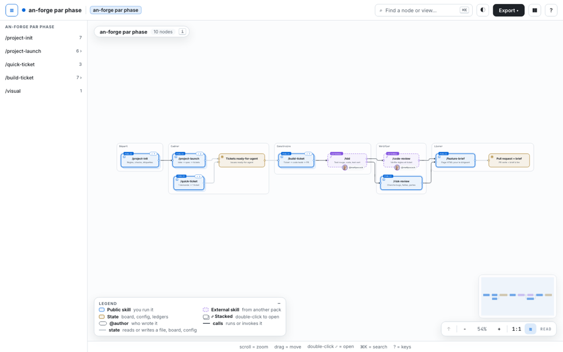](docs/skill-map/index.html)

---

## Installation

an-forge est un **plugin** : une caisse à outils qu'on installe une fois sur sa machine, et qui sert ensuite dans tous ses projets. Une seule commande suffit, selon l'outil que tu utilises :

```bash
# Claude Code (les mises à jour arrivent toutes seules)
claude plugin marketplace add arthurnicolas59/an-forge
claude plugin install an-forge@an-forge

# Autres agents : Codex, Cursor, Copilot, Gemini… (copie les skills dans le projet)
npx skills@latest add arthurnicolas59/an-forge
```

> [!NOTE]
> N'installe pas en plus le plugin de Matt Pocock : an-forge contient déjà ses skills, et chacun apparaîtrait en double.

Si le plugin ne se met pas à jour tout seul : `claude plugin marketplace update an-forge`, puis `claude plugin update an-forge@an-forge`.

Les captures d'écran et le PDF du brief utilisent **Playwright**, un outil qui pilote un navigateur invisible. Il demande Node.js 20 ou plus. La première fois, il télécharge son navigateur, Chromium (environ 150 Mo).

## Les 5 étapes

Chaque étape est décrite de la même façon : **ce que tu fais**, **ce que l'agent fait**, **ce que tu obtiens**, et surtout **pourquoi** c'est fait comme ça.

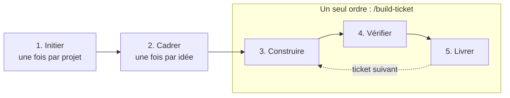

Les étapes 3, 4 et 5 s'enchaînent toutes seules : une seule commande, `/build-ticket`, les fait toutes. On les sépare ici pour bien comprendre ce qui se passe.

## 1. Initier le projet

**Ce que tu fais** : une seule fois par projet, neuf ou existant, tu tapes `/project-init`. Tu réponds à une seule question : « Êtes-vous développeur ? ».

**Ce que l'agent fait** : il regarde ce que contient déjà le projet, puis il y installe le nécessaire, sans jamais écraser un fichier existant.

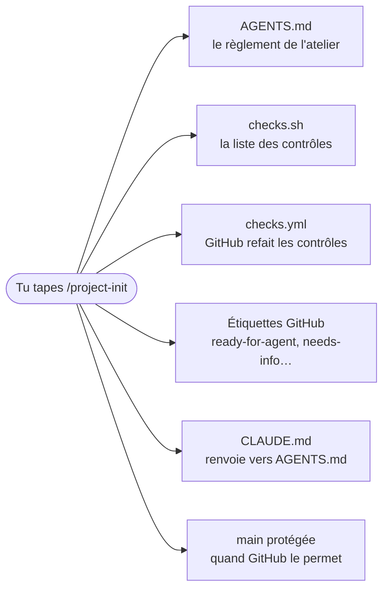

**Ce que tu obtiens** : un projet prêt à recevoir des tickets.

**Pourquoi.**
- **Ta réponse à la question change tout le reste.** Si tu n'es pas développeur, c'est écrit dans `AGENTS.md`, et tous les agents le liront : aucune question technique brute ne te sera posée. Tu recevras une recommandation expliquée simplement, que tu n'auras qu'à valider.
- **Un seul règlement, `AGENTS.md`, pour tous les outils.** Claude Code, Codex ou Cursor le lisent tous. `CLAUDE.md` ne fait que renvoyer vers lui, pour que les règles ne soient jamais écrites en double.
- **Sur un projet existant**, l'agent déduit du code les règles et les contrôles à lancer. **Sur un projet neuf**, il n'y a encore rien à déduire : ce sera fait à l'étape 2, une fois la stack choisie (la *stack*, c'est l'ensemble des technologies du projet : langage, base de données, hébergement).

## 2. Cadrer le projet

**Ce que tu fais** : tu racontes ce que tu veux. Selon la taille de la demande, tu prends l'un des deux chemins.

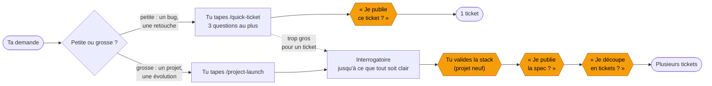

**Ce que l'agent fait**, sur le chemin long (`/project-launch`), dans une seule conversation :

1. **Il t'interroge** (skill `grill-with-docs`) jusqu'à ce qu'il ne reste plus de question ouverte. Au passage, il tient à jour deux documents : `GLOSSARY.md`, le lexique de ton projet, et les **ADR**, des fiches courtes qui notent chaque décision importante et sa raison.
2. **Il fixe le cadre** si le projet est neuf : il te propose deux ou trois stacks, avec leurs forces et leurs faiblesses, et une recommandation. Une fois ton choix fait, il remplit `AGENTS.md` et la liste des contrôles.
3. **Il écrit la spec** (skill `to-spec`) et la publie sur GitHub.
4. **Il la découpe en tickets** (skill `to-tickets`), en notant lesquels doivent attendre les autres.

**Ce que tu obtiens** : une spec et des tickets étiquetés `ready-for-agent`, c'est-à-dire « prêts pour un agent ». Par exemple :

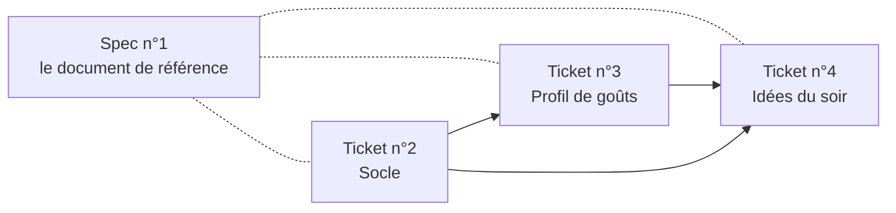

Une flèche veut dire « doit être fini avant ». La spec ne se construit pas : elle se ferme toute seule quand son dernier ticket est mergé.

**Pourquoi.**
- **Un interrogatoire serré avant tout.** Une ambiguïté coûte une question maintenant, ou un ticket entier à refaire plus tard.
- **Des tickets petits et complets.** Chaque ticket livre un comportement entier (de l'écran jusqu'aux données), assez petit pour tenir dans une session. On peut ainsi le vérifier seul, et une erreur ne touche qu'un ticket.
- **Pour un projet neuf, le premier ticket est le « socle »** : il crée le squelette du projet et fait passer les contrôles au vert. Tous les autres tickets en dépendent.
- **Tout le cadrage se fait dans une seule conversation**, parce que la spec et les tickets s'appuient sur tout ce que l'interrogatoire a établi.

## 3. Construire le ticket

**Ce que tu fais** : tu ouvres une **session neuve** et tu tapes `/build-ticket 12`, ou `/build-ticket` tout court pour prendre le premier ticket libre. Ensuite, tu n'as plus rien à faire jusqu'au brief.

**Ce que l'agent fait** :

1. **Le ménage** : il range les tickets déjà mergés (script `cleanup.sh`).
2. **Il réserve le ticket** et crée sa **branche**, `ticket/12-…`, à partir de la dernière version de `main`. Il travaille dans un dossier à part, le *worktree*, rangé dans `.worktrees/`.
3. **Il capture « l'avant »** : des captures d'écran si le changement se voit, ou la reproduction exacte du bug.
4. **Il construit en TDD** (skill `tdd`) : d'abord un test qui échoue, puis le code qui le fait passer, une petite tranche à la fois, avec une sauvegarde (un *commit*) après chaque tranche.

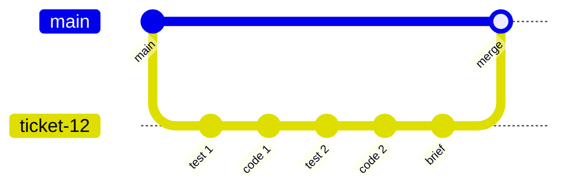

*La branche part de `main`, accumule ses sauvegardes à part, et n'y revient qu'au merge, après ta décision.*

**Ce que tu obtiens** : rien de visible pour l'instant. Le travail continue tout seul vers l'étape 4.

**Pourquoi.**
- **Une session neuve par ticket** : l'agent démarre l'esprit clair, sans les détours d'une conversation précédente.
- **Une branche et un dossier à part** : tant que tu n'as pas dit « merge », la version officielle n'est jamais touchée. Si le ticket tourne mal, on jette la photocopie, l'original est intact.
- **Le test d'abord** oblige l'agent à dire ce qu'il compte faire *avant* de le faire. Un test qui passe, c'est une preuve, pas une promesse.
- **La réservation** : créer la branche, c'est réserver le ticket. Deux sessions lancées en même temps ne peuvent pas prendre le même.

**Le choix du modèle.** Il existe plusieurs tailles de modèles d'IA : **Haiku** (rapide et économique), **Sonnet** (le milieu) et **Opus** (le plus capable, et le plus cher). Chaque ticket a une taille (`taille:petit`, `taille:moyen` ou `taille:gros`) et le script `pick-model.sh` en déduit qui construit :

| Commande | Taille du ticket | Qui construit | Qui relit |
|----------|------------------|---------------|-----------|
| `/build-ticket` | petit | Sonnet | Opus |
| `/build-ticket` | moyen, gros | Opus | Opus |
| `/build-ticket --eco` | toutes | Sonnet | Opus |
| `/build-ticket --max` | toutes | Opus | Opus |

On n'envoie pas l'ingénieur en chef changer une ampoule. Mais l'inspecteur, lui, est toujours le meilleur : la relecture ne descend jamais sous Opus. Si un ticket n'a pas de taille, un petit agent Haiku la décide.

**Un ticket à la fois**, par défaut. On peut en construire plusieurs en parallèle, avec une session par ticket, mais deux changements justes séparément peuvent se contredire une fois réunis. Choisir quels tickets avancent ensemble sera le rôle d'un futur chef d'orchestre, `/factory`, qui n'existe pas encore.

## 4. Vérifier le ticket

**Ce que tu fais** : rien. Rien n'avance tant qu'une vérification échoue.

**Ce que l'agent fait** : il fait passer son travail par trois contrôles successifs. À chaque refus, il corrige et repasse le contrôle.

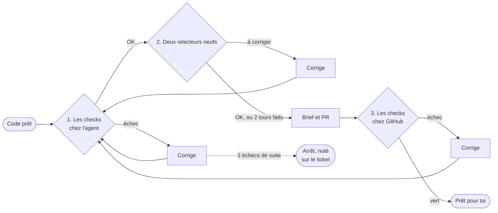

1. **Les checks chez l'agent** : le script `gate.sh` lance tous les contrôles du projet (`scripts/checks.sh`). Il refuse d'office une branche qui modifie la liste des contrôles.
2. **Deux relecteurs neufs**, deux agents qui ne voient que le changement, le ticket et les règles du projet :
   - `code-review` : le code respecte-t-il les règles du projet, et fait-il ce que le ticket demande ?
   - `risk-review` : qu'est-ce qui pourrait mal tourner (bugs, failles de sécurité, données perdues) ? Il donne un **niveau de risque**.
   Deux tours au plus : ce qui reste ensuite est écrit dans le brief.
3. **Les checks chez GitHub** : à l'ouverture de la pull request, GitHub relance les mêmes contrôles sur une machine neutre.

**Ce que tu obtiens** : un travail qui a passé les trois contrôles, ou un arrêt expliqué.

**Pourquoi.**
- **Des relecteurs neufs**, parce qu'on ne relit bien que ce qu'on n'a pas écrit. Ils ne voient pas le raisonnement du constructeur, donc ils ne peuvent pas être convaincus par lui : ils jugent seulement le résultat.
- **Les checks deux fois**, comme un contrôle technique fait par un garage indépendant plutôt que par le vendeur. Ça passe chez l'agent mais pas chez GitHub ? C'est souvent un oubli : un fichier pas sauvegardé, un outil installé seulement sur la machine de l'agent.
- **Interdit de toucher aux contrôles.** Sinon, le plus simple pour « réussir » serait de retirer le test qui échoue.

## 5. Livrer le ticket

**Ce que tu fais** : tu lis le brief, qui s'ouvre tout seul dans ton navigateur. Puis tu réponds de l'une de deux façons :
- **« merge la PR »** si le résultat te convient ;
- **ce qui ne va pas** (« le bouton est trop petit »). L'agent corrige alors, refait tous les contrôles et te redonne un brief à jour. Si ta demande sort du ticket, il te propose d'en faire un nouveau, avec `/quick-ticket`.

**Ce que l'agent fait** : avant ta décision, il prépare le brief (skills `before-after` et `feature-brief`) et ouvre la pull request. Après ton « merge », il ne merge pas les yeux fermés : le script `merge-pr.sh` vérifie d'abord trois choses.

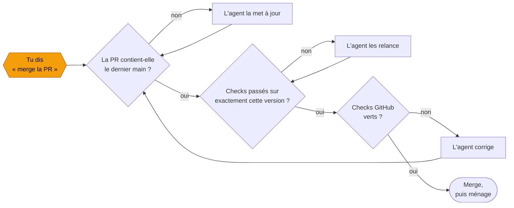

**Ce que tu obtiens** : le brief, rangé dans `docs/briefs/`, c'est-à-dire :
- **une page de synthèse** : la décision à prendre, l'objectif, les captures avant/après, la fiabilité, les choix faits en route et comment l'essayer toi-même ;
- **une annexe** : chaque critère du ticket avec sa preuve, et la liste des fichiers touchés.

**Pourquoi.**
- **L'agent ne merge jamais de lui-même**, même si tout est vert : la dernière décision est toujours la tienne.
- **Le brief contient trois informations que l'agent qui a codé ne peut pas embellir** : le niveau de risque (donné par le relecteur indépendant), le résultat des checks et la liste des tests existants supprimés ou modifiés (calculés par des scripts).
- **Les trois vérifications avant le merge**, parce qu'un autre ticket a pu être mergé pendant ce temps. Deux changements justes séparément peuvent se contredire : on revérifie donc sur la version réunie.

## La vie d'un ticket

Tout l'état d'un ticket est sur GitHub, sous forme d'étiquettes et de commentaires. Il n'y a rien à suivre ailleurs : un coup d'œil à la liste des tickets suffit pour savoir où on en est.

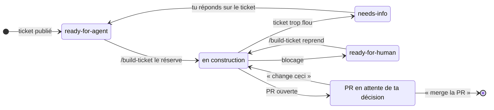

- **`needs-info`** : l'agent n'a pas voulu deviner. Il a écrit une question précise sur le ticket, avec sa recommandation, puis il est passé à autre chose. Une fois que tu as répondu, `/build-ticket 12` reprend.
- **`ready-for-human`** : l'agent s'est arrêté en route, par exemple parce que les checks ont échoué trois fois. Il a écrit sur le ticket où il s'est arrêté, ce qui bloque et ce qu'il a essayé. Son travail est gardé, et `/build-ticket 12` repart de là.

---

## Sous le capot

Tu n'as pas besoin de cette partie pour te servir d'an-forge. Elle explique de quoi la factory est faite, et comment la faire évoluer.

### Les skills et qui les appelle

Tu ne tapes que quatre commandes. Chacune appelle d'autres skills en coulisse, comme un chef d'équipe qui répartit le travail.

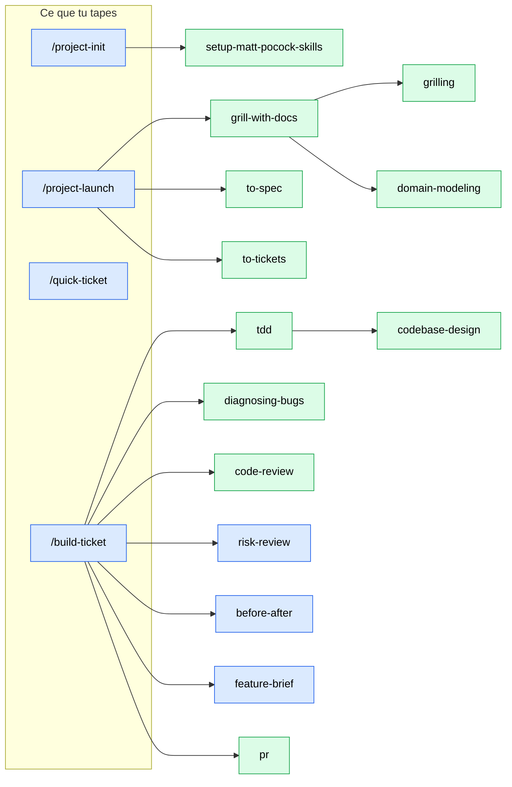

*En bleu, les skills écrits pour an-forge. En vert, ceux repris de Matt Pocock.* Un dix-neuvième skill, `visual` (repris d'Eric Tech), sert à part : il dessine des pages visuelles, comme les cartes d'an-forge.

| Étape | Skill | Rôle | Origine |
|-------|-------|------|---------|
| 1 | [`project-init`](skills/project-init/SKILL.md) | Prépare un projet pour la factory | an-forge |
| 1 | [`setup-matt-pocock-skills`](skills/setup-matt-pocock-skills/SKILL.md) | Note où vivent les tickets et les docs du projet | Matt Pocock |
| 2 | [`project-launch`](skills/project-launch/SKILL.md) | De l'idée aux tickets : interrogatoire, spec, tickets | an-forge |
| 2 | [`quick-ticket`](skills/quick-ticket/SKILL.md) | D'une petite demande à un seul ticket | an-forge |
| 2 | [`grill-with-docs`](skills/grill-with-docs/SKILL.md) | L'interrogatoire, qui tient à jour le lexique et les ADR | Matt Pocock |
| 2 | [`grilling`](skills/grilling/SKILL.md) | La technique d'interrogatoire | Matt Pocock |
| 2 | [`domain-modeling`](skills/domain-modeling/SKILL.md) | La tenue du lexique et des ADR | Matt Pocock |
| 2 | [`to-spec`](skills/to-spec/SKILL.md) | La conversation devient une spec, publiée sur GitHub | Matt Pocock |
| 2 | [`to-tickets`](skills/to-tickets/SKILL.md) | La spec devient des tickets `ready-for-agent` | Matt Pocock |
| 3 à 5 | [`build-ticket`](skills/build-ticket/SKILL.md) | D'un ticket à une PR, et reprise après ta demande de changement | an-forge |
| 3 | [`tdd`](skills/tdd/SKILL.md) | Construire test d'abord, une tranche à la fois | Matt Pocock |
| 3 | [`diagnosing-bugs`](skills/diagnosing-bugs/SKILL.md) | Reproduire un bug avant de le corriger | Matt Pocock |
| 3 | [`codebase-design`](skills/codebase-design/SKILL.md) | Le vocabulaire pour bien découper le code | Matt Pocock |
| 4 | [`code-review`](skills/code-review/SKILL.md) | Relire : règles du projet et fidélité au ticket | Matt Pocock |
| 4 | [`risk-review`](skills/risk-review/SKILL.md) | Relire : bugs, failles, données ; niveau de risque | an-forge |
| 5 | [`before-after`](skills/before-after/SKILL.md) | Captures des mêmes écrans avant et après | an-forge |
| 5 | [`feature-brief`](skills/feature-brief/SKILL.md) | Le brief : une page de synthèse et une annexe | an-forge |
| 5 | [`pr`](skills/pr/SKILL.md) | Rédiger le texte de la pull request | Matt Pocock |
| à part | [`visual`](skills/visual/SKILL.md) | Une page visuelle : résumé, plan, carte de skills | Eric Tech |

### Les scripts : les machines de contrôle

Un skill est une fiche d'instructions que l'agent lit et interprète. Un script, lui, est un programme qui fait toujours exactement la même chose. Tout ce qui doit être exact (compter, vérifier, refuser) est donc confié à un script, que chaque skill emporte dans son dossier.

| Script | Ce qu'il fait | Étape |
|--------|---------------|-------|
| `inspect.sh` | Fait l'état des lieux du projet : git, GitHub, fichiers déjà là | 1 |
| `install-template.sh` | Pose `AGENTS.md`, `checks.sh` et `checks.yml` sans rien écraser | 1 |
| `create-labels.sh` | Crée les étiquettes sur GitHub | 1 |
| `claude-md.sh` | Crée `CLAUDE.md`, qui renvoie vers `AGENTS.md` | 1 |
| `protect-main.sh` | Demande à GitHub de refuser un merge tant que les checks ne sont pas verts | 1 |
| `cleanup.sh` | Fait le ménage des tickets mergés et ferme les specs terminées | 3 |
| `tickets.sh` | Trouve le premier ticket libre, ou dit pourquoi un ticket ne peut pas démarrer | 3 |
| `start-ticket.sh` | Réserve le ticket : crée sa branche et son dossier de travail | 3 |
| `pick-model.sh` | Choisit le modèle d'après la taille du ticket | 3 |
| `gate.sh` | Lance les checks, et refuse une branche qui les modifie | 4 |
| `pr-checks.sh` | Attend le verdict des checks chez GitHub | 4 |
| `flag-ticket.sh` | Pose `needs-info` ou `ready-for-human`, avec le message, sur le ticket | 3 à 5 |
| `capture.sh` | Prend les captures d'écran avant et après | 5 |
| `render.py`, `to-pdf.sh`, `open.sh` | Fabriquent le brief (page web et PDF) et l'ouvrent | 5 |
| `merge-pr.sh` | Merge seulement si c'est sans danger, puis fait le ménage | 5 |

### Les garde-fous

Chaque garde-fou existe pour empêcher une erreur précise.

| Garde-fou | Sans lui, l'agent pourrait… |
|-----------|-----------------------------|
| **Pas de merge sans toi** | … mettre en place un changement que tu n'as pas vu |
| **Checks interdits de modification** (`gate.sh`) | … faire « passer » les contrôles en retirant le test qui échoue |
| **Checks en double**, chez l'agent puis chez GitHub | … livrer un code qui ne marche que sur sa machine |
| **Relecteurs neufs** | … être relu par quelqu'un qui partage ses angles morts |
| **Chiffres du brief calculés par des scripts** | … présenter son travail sous un jour trop favorable |
| **Trois vérifications avant le merge** (`merge-pr.sh`) | … casser `main` en réunissant deux tickets qui se contredisent |
| **Arrêt après trois échecs** | … tourner en rond sans fin, ou finir par contourner le problème |
| **Question plutôt que supposition** (`needs-info`) | … construire avec soin la mauvaise chose |

> [!NOTE]
> Avec un compte GitHub gratuit, la protection de `main` n'existe que sur un repo public. Sur un repo privé, les checks tournent quand même et `merge-pr.sh` les respecte, mais le bouton vert « Merge » de GitHub, lui, ne vérifie rien : passe toujours par « merge la PR ».

### Faire évoluer an-forge

an-forge est lui-même un repo, avec ses règles écrites dans [`AGENTS.md`](AGENTS.md). Voici ce qui se passe quand on modifie un skill :

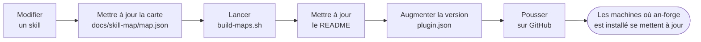

- **La version** est le numéro du plugin, par exemple `0.13.0`. Une correction augmente le dernier chiffre (`0.13.0` → `0.13.1`), un ajout celui du milieu (`0.13.0` → `0.14.0`). C'est ce numéro qui signale aux machines qu'il y a du nouveau : sans lui, elles gardent l'ancienne version.
- **Les cartes** ([page d'accueil](docs/index.html)) sont des pages fabriquées à partir de données. On ne modifie que les données, puis on relance le script :

  ```bash
  scripts/build-maps.sh            # reconstruit les pages et vérifie que chaque skill est sur la carte
  scripts/build-maps.sh --thumbs   # refait aussi les vignettes de la page d'accueil
  ```

  Le script vérifie aussi la mise en page (flèches qui se croisent, étiquettes qui se chevauchent) avec Google Chrome. Sans Chrome, les pages se construisent quand même, sans cette vérification.
- **Les skills venus d'ailleurs** (Matt Pocock, Eric Tech) sont des copies, qu'on modifie le moins possible. Pour voir ce qui a changé chez eux depuis la dernière copie :

  ```bash
  scripts/sync-upstream.sh                     # toutes les sources, en résumé
  scripts/sync-upstream.sh mattpocock --full   # une seule source, en détail
  ```

### Ce que contient ce repo

```text
AGENTS.md         les règles d'an-forge (lisibles par tous les outils)
CLAUDE.md         renvoie vers AGENTS.md, pour Claude Code
skills/           un dossier par skill : ses instructions (SKILL.md) et ses scripts
agents/           un fichier par sous-agent (vide pour l'instant)
scripts/          les scripts d'an-forge lui-même : cartes, mises à jour des copies
tests/            les tests de ces scripts
licenses/         les licences des skills venus d'ailleurs
docs/             les cartes interactives
.claude-plugin/   l'emballage qui fait d'an-forge un plugin Claude Code
```

an-forge n'est pas réservé à Claude Code :

| Élément | Claude Code | Autres outils (Codex, Cursor, Copilot, Gemini…) |
|---------|-------------|--------------------------------------------------|
| Règles et workflow | `AGENTS.md`, via `CLAUDE.md` | `AGENTS.md`, lu directement |
| Skills | installés par le plugin | copiés par `npx skills add` |
| Sous-agents | installés par le plugin | à adapter selon l'outil |

## Avancement

Fait :
- [x] Squelette et skills de Matt Pocock intégrés
- [x] `/project-init`, `/project-launch`, `/quick-ticket`
- [x] `/build-ticket` : isolation, TDD, checks, relectures, brief, PR, merge contrôlé
- [x] Checks relancés par GitHub, étiquettes `needs-info` / `ready-for-human`
- [x] Choix du modèle par taille de ticket
- [x] Cartes interactives de la factory (`docs/`)

À faire :
- [ ] Test sur un vrai projet (Recipe) : plusieurs tickets à la main
- [ ] Sous-agents dédiés (`agents/` est vide : les relectures passent par des skills)
- [ ] Tests automatiques des scripts et contrôle du bump de version
- [ ] Aperçu de déploiement par PR dans le ticket socle
- [ ] Orchestrateur `/factory` et parallèle, seulement après 10 à 20 tickets faits à la main

## Crédits

**Matt Pocock.** Ses skills sont copiés depuis [mattpocock/skills](https://github.com/mattpocock/skills) (licence MIT, voir [licenses/mattpocock-skills.txt](licenses/mattpocock-skills.txt)), pour qu'an-forge soit complet à lui seul. Modifications :
- `setup-matt-pocock-skills`, `grill-with-docs`, `to-spec` et `to-tickets` ne sont plus réservés au lancement manuel, pour qu'un skill an-forge puisse les appeler. Leur description demande de ne jamais les lancer de sa propre initiative.
- Les métadonnées de `pr` ont été retirées de l'en-tête ; les crédits restent dans `skills/pr/CREDITS.md`.

**Eric Tech.** Copiés depuis [EricTechPro/super-board](https://github.com/EricTechPro/super-board) (licence MIT, voir [licenses/super-board.txt](licenses/super-board.txt)) : le skill `visual`, le moteur de la carte de Matt (`docs/_shared/`) et la carte de Matt Pocock. `visual` est repris tel quel, sauf une retouche : le panneau de détail coupe aussi ses puces avant une majuscule accentuée. Dans le moteur, seuls la barre du haut, la liste des cartes, la comparaison entre packs et la reconnaissance des noms de skills dans un texte accentué ont été adaptés.

**Inspirations** (idées seulement) :
[rstack](https://github.com/michaelshimeles/rstack) · [zazencodes software factory v2](https://github.com/zazencodes/zazencodes-season-3/tree/main/src/software-factory-claude-code-v2)

---

*Fait par Arthur.*
