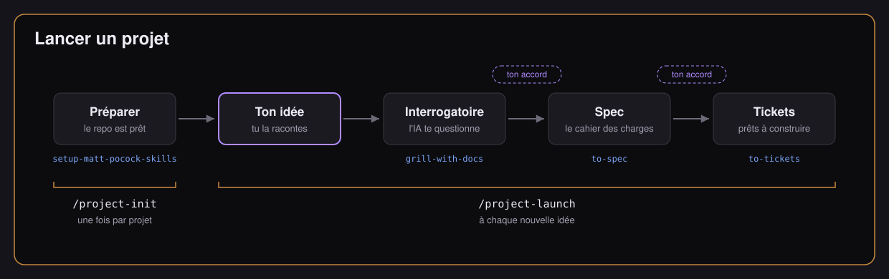
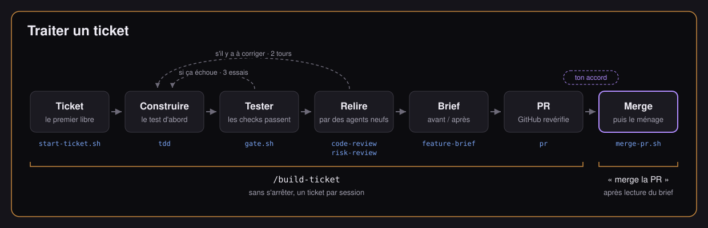

# an-forge

Ma software factory : la base que j'installe dans tous mes projets.

Une demande entre d'un côté, une pull request prête à merger sort de l'autre.
Entre les deux, une chaîne fixe où des **agents** font le travail qui demande du
jugement et des **scripts** font le travail qui doit être exact.





## Les 6 parties

| # | Partie | Qui | Rôle |
|---|--------|-----|------|
| 1 | Intake | agent | Décide si une demande vaut la peine d'être construite, et à quelle échelle |
| 2 | Orchestrateur | skill `/factory` | Lance les jobs et passe chaque étape au bon agent |
| 3 | Agents | agents | Un par rôle : spec, build, review, approbation |
| 4 | Gates | script | Tests, lint, build : rien n'avance si ça échoue |
| 5 | État | fichiers | Où en est chaque job, pour pouvoir reprendre après un arrêt |
| 6 | Sortie | GitHub | Une pull request que je merge |

## Le workflow : deux niveaux

### Niveau projet : la direction

Sert à décider quoi construire et comment. On le refait à chaque nouveau projet ou grosse évolution.

**`/project-launch`** enchaîne, dans une seule conversation :

1. `grill-with-docs` : un interrogatoire serré sur l'idée, qui tient à jour `GLOSSARY.md` (le vocabulaire du projet) et les ADR (les décisions).
2. **Le cadre** : pour un projet neuf, le choix de la stack (deux ou trois options, leurs forces et faiblesses, une recommandation à valider), puis `AGENTS.md` et `scripts/checks.sh` remplis et poussés sur GitHub.
3. `to-spec` : transforme la conversation en spec et la publie comme issue GitHub. La spec est le document de référence : elle ne se construit pas, et se ferme toute seule avec son dernier ticket.
4. `to-tickets` : découpe la spec en tickets, des tranches complètes qui tiennent chacune dans une session, avec leurs dépendances. Chaque ticket devient une sous-issue `ready-for-agent` de la spec. Pour un projet neuf, le premier est le socle.

Il s'arrête pour te demander ton accord avant de pousser le cadre, de publier la spec, puis de créer les tickets.

Si tu n'es pas développeur (`/project-init` te le demande), aucune question technique ne t'est posée brute : tu reçois une recommandation expliquée simplement, à valider.

### Niveau feature : la réalisation

Sert à construire un ticket `ready-for-agent`, dans une session neuve, un ticket par session.

**`/build-ticket <n>`** enchaîne, **sans s'arrêter** :

1. **Isoler** : `start-ticket.sh` crée la branche `ticket/<n>-…` et un worktree dans `.worktrees/`, depuis le dernier `main`.
2. **Construire** : `tdd`, test d'abord. Pour un bug, `diagnosing-bugs` le reproduit avant de le corriger.
3. **Tester** : `gate.sh` lance `scripts/checks.sh`. Rien n'avance tant qu'il échoue, et une branche qui modifie les checks est refusée.
4. **Relire** : `code-review` confie la relecture à deux agents neufs, qui ne voient que le diff, le ticket et les règles du projet. Deux tours au maximum.
5. **Résumer** : `before-after` capture les écrans avant et après, `feature-brief` écrit le brief pour le CEO dans `docs/briefs/` : une page de synthèse (décision, objectif, avant/après, fiabilité, choix effectués), puis une annexe avec les fichiers touchés.
6. **Livrer** : une pull request avec `Closes #<n>` et le lien du brief. L'agent ne merge pas de lui-même : tu lis le brief, puis tu dis « merge la PR ». `merge-pr.sh` ne merge que si la PR contient le dernier `main` et que les checks ont passé sur exactement cette version.

À chaque étape, `log-step.sh` note dans un journal ce qui se passe, en une phrase simple : `~/.an-forge/journal/<projet>/<ticket>.jsonl`, hors du projet, pour ne créer aucun commit. Il coche aussi les critères d'acceptation du ticket dès qu'un test les prouve, et inscrit le projet dans `~/.an-forge/projects`. Ce journal alimente le tableau de suivi.

## Suivre ses projets : `/dashboard`

**`/dashboard`** ouvre dans le navigateur un tableau de suivi de tous tes projets, dans le style de VS Code. Il ne fait que lire : rien n'est modifié, ni sur GitHub, ni dans les projets.

- **Projets** : chaque projet est un dossier, chaque spec un sous-dossier, chaque ticket une ligne avec son état (en construction, à relire, arrêté, prêt, bloqué, mergé).
- **Un ticket** : ce qu'il faut construire, ce qui va être fait (les critères d'acceptation, cochés dès qu'un test les prouve) et le déroulé de `/build-ticket`, chaque étape avec ce à quoi elle sert et ce qui s'y est passé.
- **Pour toi** : ce qui attend ta décision. **Activité** : les dernières étapes, tous projets confondus.

La page tourne sur ta machine (`http://127.0.0.1:4317`) et se met à jour toute seule. Elle lit GitHub, les branches locales et le journal. Un projet y apparaît dès que `/dashboard` ou `/build-ticket` a été lancé dedans. Il faut Node.js 18 ou plus et `gh` connecté. Les couleurs sont toutes en haut de `skills/dashboard/scripts/index.html`, pour changer de thème facilement.

Sur Mac, `/dashboard` propose aussi de créer l'**app an-forge** (`install-app.sh`) : une icône dans `~/Applications`, à mettre dans le Dock, qui lance le tableau et l'ouvre dans sa propre fenêtre (avec Google Chrome, sinon dans le navigateur). Elle continue de marcher après les mises à jour d'an-forge.

Au début de chaque `/build-ticket`, `cleanup.sh` fait le ménage des tickets déjà mergés et ferme les specs terminées : aucune commande à taper.

`/build-ticket` ne pose aucune question : sans numéro (ou avec celui d'une spec), il prend le premier ticket libre, celui qui a le plus petit numéro. **Par défaut, un ticket à la fois** : on lance le suivant une fois le précédent mergé. Le parallèle est possible, avec une session par ticket : chaque session réserve un ticket différent en créant sa branche. Mais deux changements corrects séparément peuvent se contredire une fois réunis, et une base de données de développement reste partagée. Ce sera le rôle de l'orchestrateur `/factory` de choisir quels tickets peuvent avancer ensemble.

Les captures et le PDF du brief utilisent Playwright : il faut Node.js 20 ou plus. La première fois, Playwright télécharge Chromium (environ 150 Mo).

## Démarrer un nouveau projet

Une seule fois par projet, neuf ou existant : **`/project-init`**. À la fin, le repo est prêt.

1. Inspecte le projet (git, GitHub, fichiers existants).
2. Pose les modèles `AGENTS.md` et `scripts/checks.sh`, sans jamais écraser un fichier existant.
3. Te demande seulement si tu es développeur. Aucune question sur le projet : s'il a déjà du code, il en déduit les règles et les checks ; s'il est neuf, c'est `/project-launch` qui les fixera.
4. Lance `setup-matt-pocock-skills` (outil de tickets, emplacement des docs).
5. Crée les étiquettes GitHub (`ready-for-agent`…), sans lesquelles la publication des tickets échoue.
6. Crée `CLAUDE.md` avec `@AGENTS.md`.

`CLAUDE.md` est créé en dernier exprès : le setup écrit sa configuration dans `CLAUDE.md` si ce fichier existe,
sinon dans `AGENTS.md`. Ainsi, toute la configuration reste dans `AGENTS.md`, lisible par tous les outils.

## Les skills

| Skill | Rôle | Origine |
|-------|------|---------|
| `project-init` | Prépare un repo pour la factory | an-forge |
| `project-launch` | De l'idée aux tickets : grill, spec, tickets | an-forge |
| `setup-matt-pocock-skills` | Configure un projet (tickets, étiquettes, docs) | Matt Pocock |
| `grill-with-docs` | Interrogatoire + glossaire et ADR | Matt Pocock |
| `grilling` | L'interrogatoire, utilisé par `grill-with-docs` | Matt Pocock |
| `domain-modeling` | Glossaire et ADR, utilisé par `grill-with-docs` | Matt Pocock |
| `to-spec` | Conversation → spec publiée en issue | Matt Pocock |
| `to-tickets` | Spec → tickets `ready-for-agent` | Matt Pocock |
| `build-ticket` | D'un ticket à une PR : isoler, construire, tester, relire, résumer | an-forge |
| `before-after` | Captures des mêmes écrans avant et après un changement | an-forge |
| `feature-brief` | Brief pour le CEO : une page de synthèse et une annexe des fichiers | an-forge |
| `dashboard` | Tableau de suivi de tous les projets, dans le navigateur | an-forge |
| `tdd` | Construire test d'abord, une tranche à la fois | Matt Pocock |
| `diagnosing-bugs` | Reproduire un bug avant de le corriger | Matt Pocock |
| `codebase-design` | Vocabulaire de conception, utilisé par `tdd` | Matt Pocock |
| `code-review` | Relire le diff selon les règles et la spec | Matt Pocock |
| `pr` | Rédiger le corps d'une pull request | Matt Pocock |

### Skills venus de Matt Pocock

Ils sont **copiés** depuis [mattpocock/skills](https://github.com/mattpocock/skills) (licence MIT, voir
[licenses/mattpocock-skills.txt](licenses/mattpocock-skills.txt)), pour qu'an-forge soit complet à lui seul
et que ses skills puissent s'enchaîner.

Modifications par rapport à l'original :
- `setup-matt-pocock-skills`, `grill-with-docs`, `to-spec` et `to-tickets` ne sont plus réservés au lancement
  manuel, pour qu'un skill an-forge puisse les appeler. Leur description demande de ne jamais les lancer de
  sa propre initiative.
- Les métadonnées de `pr` ont été retirées de l'en-tête ; les crédits restent dans `skills/pr/CREDITS.md`.

Pour voir ce qui a changé chez Matt depuis la dernière copie :

```bash
scripts/sync-matt.sh          # résumé
scripts/sync-matt.sh --full   # diff complet
```

## Structure du repo

```
AGENTS.md         les règles de la factory (source unique, lisible par tous les outils)
CLAUDE.md         importe AGENTS.md pour Claude Code
skills/           un dossier par skill (SKILL.md, format ouvert Agent Skills)
agents/           un fichier par sous-agent
scripts/          scripts d'an-forge (sync-matt.sh, mattpocock.lock)
licenses/         licences des skills venus d'ailleurs
docs/             la carte de la factory (factory.canvas pour Obsidian, lancement-projet.svg et traitement-ticket.svg pour tous)
.claude-plugin/   l'emballage pour Claude Code
```

## Portabilité

| Élément | Claude Code | Autres outils (Codex, Cursor, Copilot, Gemini…) |
|---------|-------------|--------------------------------------------------|
| Règles et workflow | `AGENTS.md` via `CLAUDE.md` | `AGENTS.md` lu directement |
| Skills | plugin | `npx skills add` |
| Sous-agents | plugin | à adapter selon l'outil |

## Installation

**1. Les outils**, une seule fois par machine, selon ton agent. an-forge contient tout ce dont il a besoin.

```bash
# Claude Code (mises à jour automatiques)
claude plugin marketplace add arthurnicolas59/an-forge
claude plugin install an-forge@an-forge

# Autres agents (copie les skills dans le projet)
npx skills@latest add arthurnicolas59/an-forge
```

N'installe pas en plus le plugin de Matt Pocock : chaque skill apparaîtrait en double.

**2. Le projet** : lance `/project-init` dedans (voir [Démarrer un nouveau projet](#démarrer-un-nouveau-projet)).

## Avancement

- [x] Étape 1 : squelette
- [x] Niveau projet : skills de Matt Pocock intégrés
- [x] `/project-init` et `/project-launch`
- [x] Étape 2 : niveau feature (`/build-ticket`)
- [ ] Étape 3 : agents
- [ ] Étape 4 : gates et état
- [ ] Étape 5 : orchestrateur `/factory`
- [x] Image du lancement d'un projet (docs/lancement-projet.svg)
- [x] Image du traitement d'un ticket (docs/traitement-ticket.svg)
- [ ] Étape 6 : test sur un vrai projet
- [x] Tableau de suivi, 1 : journal des étapes (`log-step.sh`)
- [x] Tableau de suivi, 2 : la page (`/dashboard`)
- [x] Tableau de suivi : l'app an-forge sur le Mac
- [ ] Tableau de suivi, 3 : les boutons pour agir

## Inspirations

- [mattpocock/skills](https://github.com/mattpocock/skills)
- [michaelshimeles/rstack](https://github.com/michaelshimeles/rstack)
- [zazencodes software factory v2](https://github.com/zazencodes/zazencodes-season-3/tree/main/src/software-factory-claude-code-v2)
