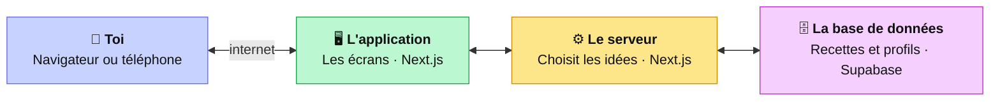

<!-- Exemple de fiche ARCHITECTURE.md, pour un projet inventé « Recettes du soir ». Faite par /project-architecture (an-forge). -->

# Architecture de Recettes du soir

> Comment ce projet est construit, expliqué pour quelqu'un qui ne lit pas le code.
> Tenu à jour par `/project-architecture` (an-forge) : la liste des dossiers est vérifiée par un script.

## 1. Vue d'ensemble

Tu ouvres l'application dans ton navigateur. Elle demande au serveur trois idées de repas ; le serveur les choisit parmi les recettes de la base de données, d'après ton profil de goûts.



## 2. Les technologies

Les outils choisis pour construire le projet, et à quoi sert chacun.

| Partie | Technologie | À quoi ça sert |
|--------|-------------|----------------|
| Écrans | Next.js | Fabrique les pages que tu vois et sur lesquelles tu cliques |
| Langage | TypeScript | La langue du code ; elle repère beaucoup d'erreurs avant même de lancer l'application |
| Apparence | Tailwind CSS | Les couleurs, les tailles et la mise en page |
| Serveur | Next.js (routes API) | Reçoit les demandes de l'application et choisit les recettes |
| Données | Supabase (PostgreSQL) | Garde les recettes, les profils et les comptes |
| Connexion | Supabase Auth | Vérifie qui tu es quand tu te connectes |
| Hébergement | Vercel | Met l'application en ligne, accessible à tous |

## 3. Les dossiers du projet

Où se trouve chaque chose. Un dossier, c'est un tiroir : chacun range un seul type de contenu.

<!-- an-forge:dossiers profondeur=2 -->
```text
recettes/
├── .github/         # Les réglages de GitHub
│   └── workflows/   # Les contrôles que GitHub relance sur chaque PR
├── docs/            # La documentation du projet
│   └── adr/         # Les décisions importantes, une fiche par décision
├── src/             # Le code de l'application
│   ├── app/         # Les pages : une par adresse du site
│   ├── components/  # Les morceaux d'écran réutilisés partout (boutons, cartes…)
│   ├── hooks/       # Les petits outils qui relient les écrans aux données (ex. : ton profil)
│   └── lib/         # Les outils communs, dont la connexion à Supabase
└── tests/           # Les tests qui vérifient que tout marche
```
<!-- /an-forge:dossiers -->
