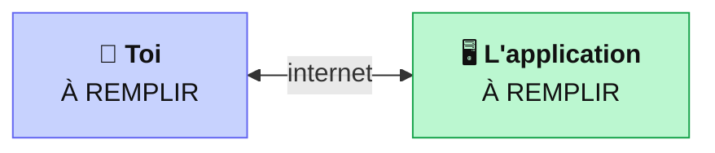

# Architecture de <Nom du projet>

> Comment ce projet est construit, expliqué pour quelqu'un qui ne lit pas le code.
> Tenu à jour par `/project-architecture` (an-forge) : la liste des dossiers est vérifiée par un script.

## 1. Vue d'ensemble

À REMPLIR : en une ou deux phrases, comment le projet fonctionne, du point de vue de celui qui l'utilise.



## 2. Les technologies

Les outils choisis pour construire le projet, et à quoi sert chacun.

| Partie | Technologie | À quoi ça sert |
|--------|-------------|----------------|
| À REMPLIR | | |

## 3. Les dossiers du projet

Où se trouve chaque chose. Un dossier, c'est un tiroir : chacun range un seul type de contenu.

<!-- an-forge:dossiers profondeur=2 -->
```text
<Nom du projet>/
```
<!-- /an-forge:dossiers -->
